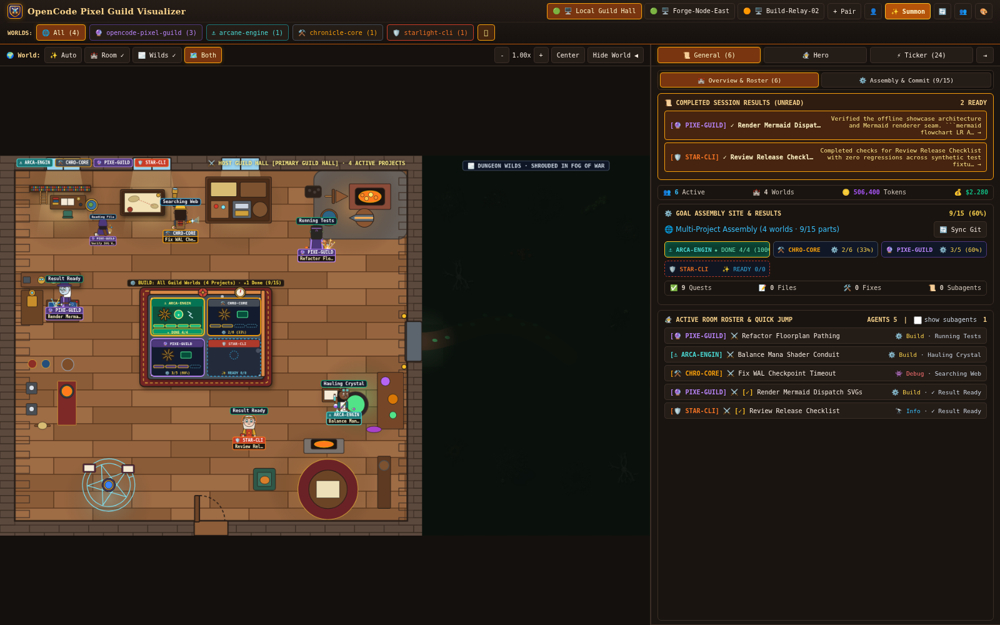
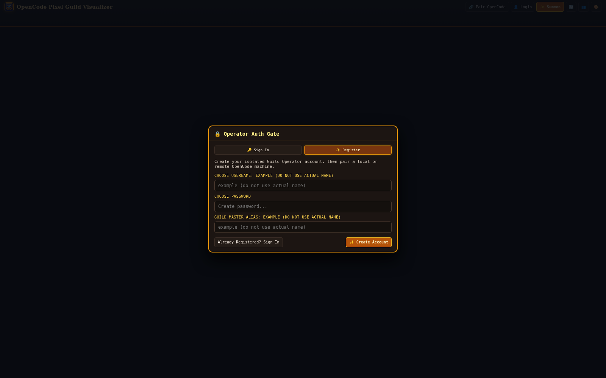
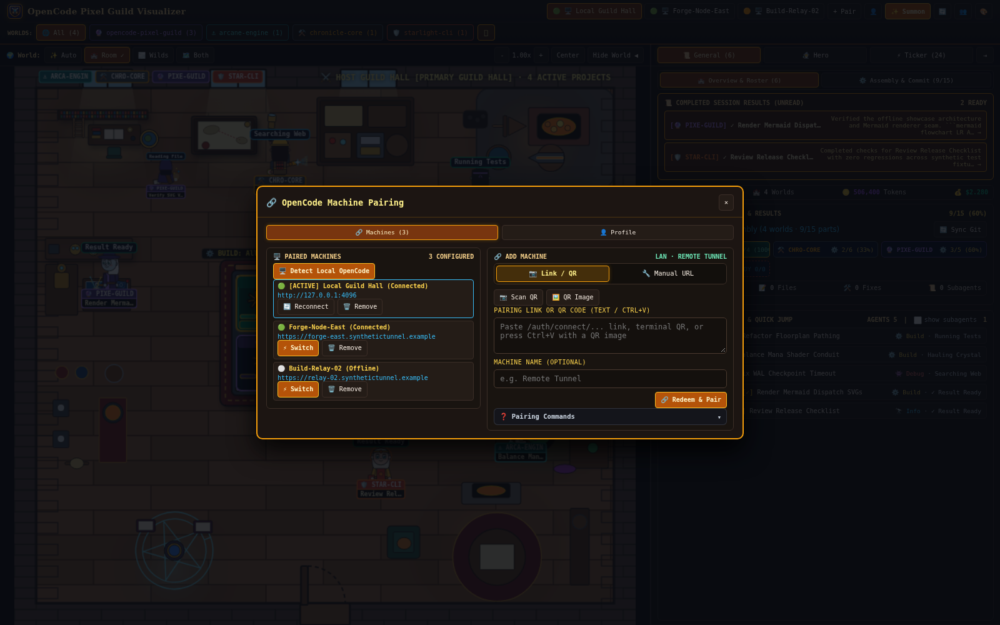
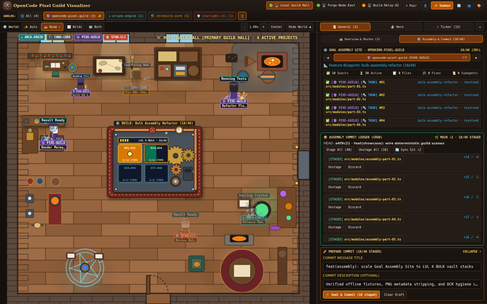
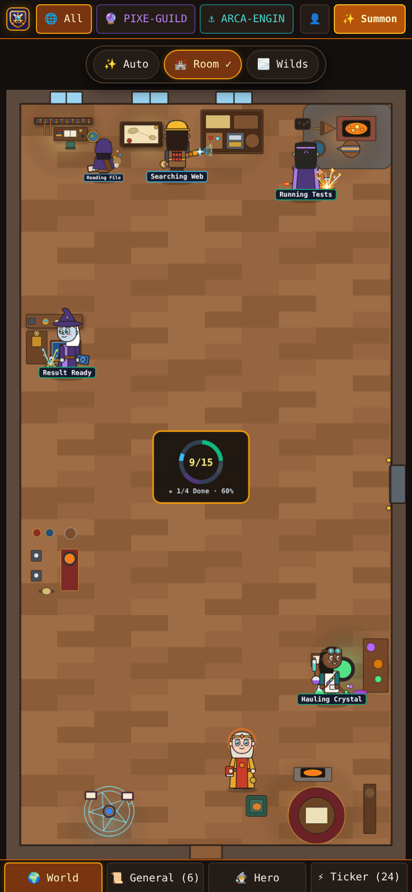
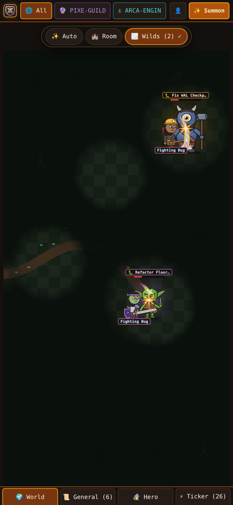
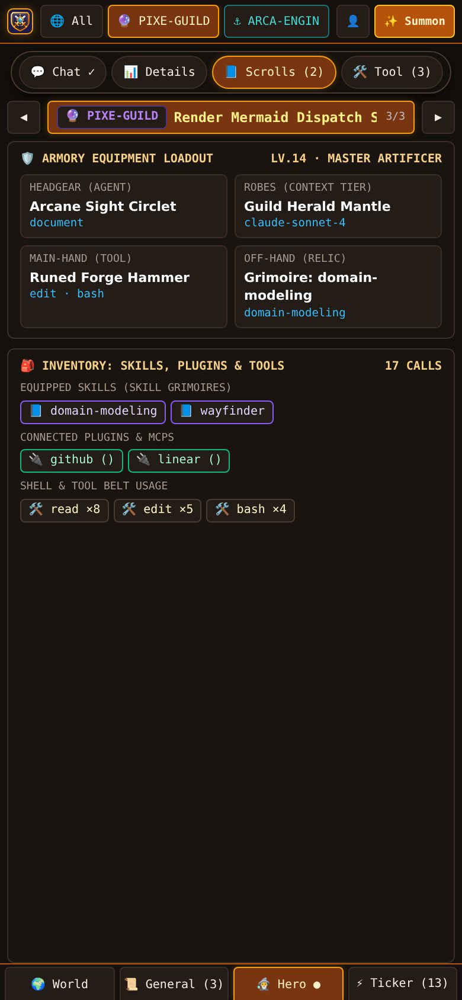

# OpenCode Pixel Guild Visualizer [](https://github.com/nirtus/opencode-pixel-guild/releases/tag/v0.2.1)

**OpenCode Pixel Guild Visualizer** (`opencode-pixel-guild-visualizer`) is a real-time 2D RPG and workshop companion for **OpenCode V2**. It turns live OpenCode hosts, projects, worktrees, root sessions, subagents, tool calls, skills, and debugging turns into an interactive **Guild Floorplan** where heroes craft features inside a shared **Workshop Room** and battle **Bug Monsters** in the **Dungeon Wilds**.


---

## Table of Contents

1. [What This App Does](#what-this-app-does)
2. [Visual Tour](#visual-tour)
3. [OpenCode V2 to Pixel Guild Mapping](#opencode-v2-to-pixel-guild-mapping)
4. [Guild Role Archetypes & Preparation Stations](#guild-role-archetypes--preparation-stations)
5. [How to Install & Run](#how-to-install--run)
   - [Option 1: Run with Docker Compose (Recommended)](#option-1-run-with-docker-compose-recommended)
   - [Option 2: Run Locally with Node.js 22+](#option-2-run-locally-with-nodejs-22)
   - [Environment Variables](#environment-variables)
   - [Agent Plugin & Skill Setup (`graphify`, `superpowers`, `mattpocock/skills`)](#agent-plugin--skill-setup-graphify-superpowers-mattpocockskills)
6. [How to Use the Visualizer](#how-to-use-the-visualizer)
   - [1. Register or Log In at the Operator Auth Gate](#1-register-or-log-in-at-the-operator-auth-gate)
   - [2. Pair Local or Remote OpenCode Machines](#2-pair-local-or-remote-opencode-machines)
   - [3. Navigate the Floorplan, Project Heraldry & Chamber Focus Modes](#3-navigate-the-floorplan-project-heraldry--chamber-focus-modes)
   - [4. Track Results & Commit Git Changes in the Guild Master Ledger](#4-track-results--commit-git-changes-in-the-guild-master-ledger)
   - [5. Inspect, Chat With & Steer Heroes in the Character Sheet](#5-inspect-chat-with--steer-heroes-in-the-character-sheet)
   - [6. Summon New Adventurers & Demolish Rooms](#6-summon-new-adventurers--demolish-rooms)
   - [7. Mobile & Home-Screen Web App Experience](#7-mobile--home-screen-web-app-experience)
7. [OpenCode Ecosystem & Disclaimer](#opencode-ecosystem--disclaimer)

---

## What This App Does

- **Unified Host Workshop Room with Project Heraldry**: All active OpenCode projects and Git worktrees on a paired machine share one **Workshop Room** and **Dungeon Wilds**, distinguished by project-colored uniforms, `[CREST TAG]` nameplates, and North Wall pennants.
- **Autonomous Character Choreography**: **Guild Adventurers** enter through the **South Swinging Guild Door**, walk along smooth floor paths, pace in contemplative circuits while thinking, haul **Resource Cargo** from the **Resource Stockpile**, and work at specialized **Preparation Stations**.
- **Outdoor Debugging Hunts & Monster Combat**: Debugging sessions venture into the **Dungeon Wilds**, cast **Lantern Flares** during searches to clear **Fog of War**, and fight their bound **Bug Monster** until tests pass.
- **Interactive Command & Git Control**: Prompt idle heroes, steer or stop active turns, switch **OpenCode Agent Modes** and **OpenCode Models** (grouped by provider with conditional reasoning `#variant` selection) live in **Command Scroll**, attach `@skill` grimoires, answer permission/question **Quest Gates**, and stage or commit Git changes in the **Assembly Commit Ledger**.
- **Inline Mermaid Diagram Graphics**: Fenced ` ```mermaid ` blocks inside assistant/user responses in the **Character Sheet** (`Chat` tab) and **Quest Gate** cards render locally as crisp, XSS-safe inline SVG graphics (`flowchart`/`graph`, `sequenceDiagram`, `stateDiagram-v2`, `classDiagram`, `erDiagram`, and `pie`) with zero external dependencies, a collapsible `Source` viewer, and graceful streaming fallback.
- **Long-Session 30 FPS Runtime Stability**: Self-healing browser SSE streaming (`event: heartbeat` version-drift catch-up, 35s zombie-socket reopen, `visibilitychange`/`online`/`pageshow` immediate resync, and server-restart/reducer-reset epoch-safe snapshot gating), host-scoped coalesced SSE broadcasts with per-client backpressure drain catch-up and mid-chunk stream reader cancellation across paired host switches, delta-only Activity Ticker logs, lazy per-turn memoized Markdown rendering, `WeakMap`-cached heraldry & underfoot nameplate rendering, bounded `Toil Queue` tool caches with instant Quest Gate (`?`/`!`) and `✓ Result Ready` backlog preemption, automatic client cache pruning, and pre-persistence `Archived` payload compaction (text-bounded + on-demand SQLite transcript re-hydration) keep characters live, responsive, and memory-flat across multi-hour sessions without ever requiring a page reload.

---

## Visual Tour

| Split Chamber View (`65%` Workshop Room / `35%` Dungeon Wilds) | Dungeon Wilds & Per-Bug Monster Combat |
| :---: | :---: |
|  |  |
| **Character Sheet (`Chat`, Inline Mermaid SVG & Model/Variant Controls)** | **Assembly Commit Ledger (Interactive Git CRUD)** |
|  |  |
| **Quest Gate Two-Way Sync, Collapse & Quiet Bypass** | **4-Scene Intro Tour (`/?demo=intro-tour` Full-Bleed Sizzle)** |
|  |  · [🎬 `opencode-pixel-guild-intro.mp4` (1080p)](./docs/video/opencode-pixel-guild-intro.mp4) · [📖 Chapters](./docs/video/youtube-publish-guide.md) |

---

## OpenCode V2 to Pixel Guild Mapping

| OpenCode V2 Concept | Pixel Guild Entity | How It Behaves in the World |
| :--- | :--- | :--- |
| **Paired OpenCode Host** | **Workshop Room** & **Dungeon Wilds** | One shared guild hall per host machine, switchable from the top header's machine strip. |
| **Project & Git Worktrees** | **Project Heraldry** & **World Focus Aura** | Characters wear project uniforms and `[CREST TAG]` badges; focusing a world highlights its heroes and dims others. |
| **Root Session** | **Guild Adventurer** | Primary 2D RPG hero outfitted according to its active **OpenCode Agent Mode** and **Guild Role Archetype**. |
| **Child Session** | **Squad Subagent** | Summoned at the **Arcane Lectern** pentagram by its parent adventurer, executes delegated tasks, and returns a **Report Scroll** on completion. |
| **Agent Profile** | **OpenCode Agent Mode** | Primary modes (`build`, `plan`, `document`, or custom) selectable on summon or switched live to change the hero's outfit. |
| **Chat Model & Effort** | **OpenCode Model** | Per-room enabled chat models (`GET /api/model`, `GET /api/model/default`, `GET /api/provider`) grouped by provider with optional `#variant` effort levels, switched live exclusively in **Command Scroll** (`POST /api/session/{sessionID}/model`) to rescale **Context Mana** immediately. |
| **Tool Execution** | **Preparation Station** & **Work Implement** | Heroes walk to the matching station perimeter and wield the corresponding craft implement. |
| **Loaded Skill** (`@skill`) | **Skill Grimoire** | Equipped at the **Armory Wardrobe** and carried in the hero's off-hand across turns. |
| **MCP Servers & Plugins** | **Resource Stockpile** & **Resource Cargo** | North-wall supply depot where heroes pick up raw materials before heading to workstations. |
| **Feature Tasks & Modified Files** | **Goal Assembly Site** & **Project Mini-Assemblies** | Central platform showing per-project **Mini-Assemblies** in `🌐 All` mode or a full-scale assembly platform when a single project is focused. |
| **Debugging & Failing Tests** | **Dungeon Wilds**, **Lantern Flares** & **Bug Monsters** | Searches pulse **Lantern Flares** through **Fog of War**; fixes and test runs send heroes to fight their bound **Bug Monster**. |
| **Context Window & Compaction** | **Context Mana** & **Compaction Exhalation** | Context usage bar; compaction plays an in-place **Compaction Exhalation** (`Compacting...`) vapor cloud above the hero. |
| **Permissions & Questions** | **Quest Gate** (`!` Lock / `?` Question) | Overhead alert marker that pauses the hero across consecutive structured (`/api/question`, `/api/form`, `question` tool) and conversational turns, synchronizes two-way when answered in OpenCode TUI/CLI/web, and renders collapsible (`Collapse ▾`), bypassable (`Bypass ✕`) approval or question choices in the **Character Sheet**. |
| **Completed Session Output** | **Unread Session Result** (`✓ Result Ready`) | Finished sessions rest in the **Break Lounge** with a `✓ Result Ready` badge until viewed, remain resting while their session tab is fresh in the OpenCode TUI (`tabs.json` / `session.json`), and automatically archive once closed or superseded by newer non-tabbed sessions so `Active Squads` counts and sprites stay strictly in sync with live OpenCode sessions. |
| **User Prompt Dispatch** | **Command Scroll** | Always-accessible prompt composer (`/` shortcut, available even beneath an active **Quest Gate**) serving as the single canonical home for switching **OpenCode Agent Mode**, **OpenCode Model** (and conditional `#variant`), attaching `@skill` grimoires, waking idle heroes, steering busy turns, bypassing a gate, or stopping execution. |
| **Working-Tree Git Changes** | **Assembly Commit Ledger** | Built-in Git panel for inspecting diffs, staging or discarding files, syncing remotes, and sealing commits. |

---

## Guild Role Archetypes & Preparation Stations

### Six Guild Role Archetypes (RPG Jobs)

| Archetype | OpenCode Modes, Skills & Specialties | Combat Weapon Archetype (Dungeon Wilds) |
| :--- | :--- | :--- |
| **`WARRIOR`** | `build`, `implement`, `tdd`, `diagnosing-bugs`, and test/fix tasks | **Broadsword Cleave** with Heater Shield |
| **`MAGE`** | `general`, `document`, `wayfinder`, `domain-modeling`, and orchestration | **Crystal Staff Arcane Barrage** with Runic Sigil |
| **`SCOUT`** | `plan`, `explore`, `research`, `find-skills`, and reconnaissance | **Longbow Riser Grip** with Feathered Arrow Volley |
| **`ALCHEMIST`** | `prototype`, `codebase-design`, Code Mode (`execute`), and MCP synthesis | **Steel Dagger Viper Thrust** with Sonic Ring |
| **`CLERIC`** | `code-review`, `grilling`, `pr`, `report`, and QA verification | **Steel Dagger Viper Thrust** with Speed Streaks |
| **`SAPPER`** | `demolition`, `cleanup`, `prune`, and worktree/container teardown | **Overhead Miner's Pickaxe Slam** with Shockwave Ring |

### Indoor Preparation Stations & Fixtures

| Station / Fixture | Location in Workshop Room | Triggered By | Work Implement Held |
| :--- | :--- | :--- | :--- |
| **Library Study Bookshelf** | North-West Wall | `read`, `glob`, `grep`, `list`, `lsp` | Open Codex & Magnifying Loupe |
| **Observatory Spyglass** | North Wall | `websearch`, `webfetch`, external docs | Brass Spyglass Telescope & Compass |
| **Resource Stockpile** | North Wall | MCP calls, plugin tools, cargo pickup | Timber Planks, Stone Block, Iron Bar, Crystal, Scroll |
| **Anvil Forge** | North-East Corner | `bash` / shell commands, builds, tests | Blacksmith's Forge Hammer & Iron Tongs |
| **Crafting Workbench** | West Wall (Upper) | `edit`, `write`, `apply_patch` | Brass Machinist Spanner & Blueprint Board |
| **Armory Wardrobe** | West Wall (Lower) | First tool equip, `skill` tool, or `@skill` | Skill Grimoire & Equipment Loadout |
| **Arcane Lectern** | South-West Corner | `subagent` / `task` orchestration | Runic Summoning Tome & Pentagram Circle |
| **Alchemy Lab** | South-East Wall (Upper) | Refactoring, synthesis, `execute` | Wooden Stirring Ladle & Boiling Flask |
| **Break Lounge** | South-East Corner | Idle, resting, or completed sessions | Hearth Fireplace, Tavern Table & Armchair |
| **Goal Assembly Site** | Center of Room | Fitting **Assembly Parts** from deliverables | Blueprint Platform & Clockwork Gears |

---

## How to Install & Run

### Prerequisites

- **Docker Runtime (Recommended)**: **Docker** and **Docker Compose**.
- **Local Node.js Runtime**: **Node.js 22+** (runs TypeScript natively with zero external npm dependencies) and **Git**.

### Option 1: Run with Docker Compose (Recommended)

1. **Clone the repository:**
   ```bash
   git clone https://github.com/nirtus/opencode-pixel-guild.git
   cd opencode-pixel-guild
   ```

2. **Build and start the container on port `4310`:**
   ```bash
   npm run docker:up
   ```

3. **Open the visualizer in your browser:**
   Visit **[http://127.0.0.1:4310](http://127.0.0.1:4310)**.

4. **Manage the container:**
   ```bash
   docker ps --filter "name=opencode-pixel-guild-visualizer"
   npm run docker:logs
   npm run docker:down
   ```

### Option 2: Run Locally with Node.js 22+

```bash
# Start the server on http://127.0.0.1:4310
npm start

# Run the automated test suite
npm test

# Re-record the 1080p MP4 intro video and README animated GIF preview
npm run demo:video
```

### Environment Variables

| Variable | Default | Description |
| :--- | :--- | :--- |
| `PORT` | `4310` | HTTP port for the web UI, SSE stream, and REST API. |
| `HOST` | `0.0.0.0` | Network interface bind address. |
| `OPENCODE_SERVICE_URL` | *(auto-discovered)* | Explicit default URL for an OpenCode V2 daemon (e.g., `http://127.0.0.1:4096`). |
| `OPENCODE_SERVICE_PASSWORD` | *(empty)* | Optional password or bearer token for `OPENCODE_SERVICE_URL`. |
| `OPENCODE_SERVICE_FILE` | `~/.local/state/opencode/service.json` | Path to the local OpenCode service discovery file. |
| `OPENCODE_DAEMON_PORT` | `4096` | Default OpenCode daemon port used when resolving local pairing links inside Docker. |
| `OPENCODE_DOCKER_HOST` | `host.docker.internal` | Hostname used inside Docker to reach a daemon on the host machine. |

### Agent Plugin & Skill Setup (`graphify`, `superpowers`, `mattpocock/skills`)

To install, configure, and verify **`graphify`** (knowledge graph CLI, git hooks, and `docs/graphify-out/` AST index), **`superpowers`**, and **`mattpocock/skills` (all 27 engineering & productivity skills + `/setup-matt-pocock-skills`)** across OpenCode V2/V1 or any other coding agent harness, follow the portable 5-stage runbook in `docs/agents/plugin-setup.md`.

---

## How to Use the Visualizer

### 1. Register or Log In at the Operator Auth Gate



- Enter a **Username**, **Password**, and optional **Guild Master Alias**, then click **✨ Create Account** (or switch to **🔑 Sign In**).
- Each operator account is persisted locally in `./data/` with isolated world state, preferences, and paired OpenCode machines.
- Once signed in, clicking **`👤`** opens the compact **Guild Operator Profile** modal (with collapsible **Change Password**, **Switch / Register**, **Logout**, and a collapsed **⚠️ Danger Zone** for account deletion) without duplicating the machine pairing form.

---

### 2. Pair Local or Remote OpenCode Machines

| OpenCode Machine Pairing Modal (`Link / QR` & `Manual URL`) | Responsive Row-1 Paired Machine Strip & Availability |
| :---: | :---: |
|  |  |

- Click **`🔗 Pair OpenCode`** / **`+ Pair`** (visible on desktop and tablets `>= 600px`, or switch to **`🔗 Machines`** inside the modal on compact phones) to open the dedicated **OpenCode Machine Pairing** window.
- Use **🖥️ Detect Local OpenCode** for local auto-discovery, or toggle between **📷 Link / QR** (paste an `opencode pair --remote` / `opencode pair --url http://<LAN-IP>:4096` link or terminal QR, scan via camera, or upload/paste a QR screenshot) and **🔧 Manual URL** (direct daemon URL + optional password/token). Pairing CLI hints expand automatically when `0` machines are paired and tuck into a collapsible **❓ Pairing Commands** disclosure once configured.
- Click any paired machine pill in the top header bar to switch your active **Workshop Room** to that host—immediately displaying `⏳ Switching...`, aborting in-flight HTTP and mid-chunk SSE stream reads to the previous host (discarding partial event buffers, old connection cursors, and pending coalesced broadcasts while enforcing connection ownership separately from snapshot version numbers so a newly switched host starting at a lower version renders immediately), running parallel discovery + two-phase bounded session hydration + non-blocking compound single-shell remote Git enrichment over your existing live SSE stream with machine-scoped warm caches, continuously reflecting live availability (`🟢` `Connected` vs. `🟠` `Offline`) across all paired machines in the top header strip and **OpenCode Machines** modal, and atomically isolating and reconciling all **Workshop Rooms**, `0`-session registered worlds, **Guild Characters**, **OpenCode Agent Modes**, **Lifetime Tribute**, and **Goal Assembly Site** / **Assembly Commit Ledger** state without cross-machine leakage—or click **Detect & Pair Local OpenCode** for local auto-discovery.
- On desktop viewports (`> 960px`), the top header's paired machine strip claims all remaining Row-1 horizontal space alongside `+ Pair` without a rigid `480px` cutoff, gracefully shrinking machine pills with CSS ellipsis (`…`) when space tightens and automatically revealing `◀` / `▶` scroll navigation buttons (plus horizontal wheel scrolling) whenever many paired machines exceed Row-1 width so no machine button is ever hidden under `+ Pair`.

---

### 3. Navigate the Floorplan, Project Heraldry & Chamber Focus Modes

| `🌐 All` Worlds Selected (All-Worlds Game Master Aggregation) | Specific World Selected (Single-World Scope & Subagent Roster) |
| :---: | :---: |
|  |  |

- **Project Worlds Bar (`Worlds:`)**: Select `🌐 All` to view all projects together with composite **Project Mini-Assemblies** (`★ DONE`, `⚙️ IN PROGRESS`, `📐 OPEN`, `✨ READY`), or click a project pill (e.g., `opencode-pixel-guild` or `arcane-engine`) to focus its heroes with an underfoot **World Focus Aura** and scope the **Spectator Drawer** to that project.
- **Add Project Worlds (`＋`)**: Click `＋` at the end of the `Worlds:` bar to browse workspace folders discovered directly on the currently active **OpenCode Machine Pairing**, register a folder as a new project world, or immediately summon an adventurer into it.
- **Chamber Focus (`World:` Toolbar)**: Switch between `Auto` (expands **Dungeon Wilds** automatically during outdoor bug hunts), `Room`, `Wilds`, and `Both` (`65% / 35%` split).
- **Camera & Layout Controls**: Drag to pan, scroll or click `-` / `+` to zoom, drag the vertical divider to resize the desktop split, or toggle `Hide World` / `⇥` to collapse either pane.

---

### 4. Track Results & Commit Git Changes in the Guild Master Ledger

Clicking empty floor space (or pressing `Escape`) opens the **Guild Master Ledger** (`General` tab):

#### `Overview & Roster` Subtab

- **Completed Session Results (Unread)**: Displays finished sessions waiting with `✓ Result Ready`; clicking any entry opens **Hero Chat** and marks the result as read.
- **Telemetry, Lifetime Tribute & Demolition**: Shows active hero count, world count, cumulative **Lifetime Tribute** (`🪙 Tokens` and `💰 Cost`), and—when a single world is focused—the **Demolish** button.
- **Goal Assembly & Active Room Roster**: Summarizes assembly progress with an inline **🔄 Sync Git** action, lists active **Bug Monsters**, and provides a quick-jump roster whose header shows `agents <count> | show subagents <count>` with a `show subagents` checkbox (agent and subagent counts stay stable regardless of subagent visibility). When `show subagents` is enabled, **Squad Subagents** render grouped immediately beneath their parent **Guild Adventurer** (or parent subagent, capped at 3 visual nesting levels) with **Project Heraldry**-tinted tree-bracket connectors (`├─` / `└─`), recessed child row styling, and `✦ <class>` badges (omitting the redundant `[Project]` pill on attached children, while detached/orphan subagents remain at top level with their **Project Heraldry** pill retained), keeping `Active Squads` world session counters and visible characters strictly synchronized with live OpenCode sessions.

#### `Assembly & Commit` Subtab

| Standard Volume Level (`LVL 2 STD · 3/5`) & Commit Ledger | Bulk Volume Level (`LVL 4 BULK · 18/48`) |
| :---: | :---: |
|  |  |

- Select a project repository using the single-row project switcher at the top of **Goal Assembly Site**.
- On the 2D **Goal Assembly Site** in the center of the **Workshop Room**, **Assembly Parts** scale dynamically across 5 bounded visual volume levels (`Level 0 READY`, `Level 1 LIGHT` for `1–4` items, `Level 2 STD` for `5–12` items, `Level 3 HVY` for `13–24` items, and `Level 4 BULK` for `25+` items), grouping large change sets into at most `4–6` stacked cluster sockets (`#01–#06`, `X/Y ITEMS`) so any number of items fits cleanly inside the assembly square while the full per-file breakdown remains inspectable in `Assembly & Commit`.
- Inspect uncommitted working-tree files (`[STAGED]`, `[MOD]`, `[NEW]`), stage or unstage changes, discard edits, sync with upstream (`🔄 Sync Git`), and click **Seal & Commit** to commit changes and reset the assembly platform.

---

### 5. Inspect, Chat With & Steer Heroes in the Character Sheet

Click any hero on the canvas or in the roster to open their **Character Sheet** (`Hero` tab):

| `Chat` (Mermaid SVGs, Model/Variant & Command Scroll) | Active `?` Quest Gate (Two-Way Sync, Collapse & Bypass) |
| :---: | :---: |
|  |  |
| **`Scrolls & Gear` (Equipment Loadout & Grimoires)** | **`Tool Log` (Executed Tool & Shell History)** |
|  |  |

- **`Chat`**: Review the **Adventurer Dispatch Log** (collapsed into one-liners by default; click any row or `Expand All ▾` for full Markdown—including zero-dependency inline SVG **Mermaid diagrams** for `flowchart`, `sequenceDiagram`, `stateDiagram-v2`, `classDiagram`, `erDiagram`, and `pie` blocks with a collapsible `Source` viewer), resolve, collapse (`Collapse ▾`), or quietly bypass (`Bypass ✕`) `!` Permission and `?` Question **Quest Gates** with clickable option pills (or answer them directly in OpenCode TUI/CLI/web with automatic two-way sync), and use the always-accessible bottom **Command Scroll** composer (`/` shortcut) to attach `@skill` badges, switch **OpenCode Agent Modes** and **OpenCode Models** (with conditional `#variant` effort selection for root **Guild Adventurers** and automatic error rollback), and steer, bypass a gate (automatically dismissing pending daemon forms/permissions), or stop the hero with truthful daemon response verification and error feedback.
- **`Details`**: Inspect read-only session ID, active **OpenCode Model** (with `#variant` when active), **Context Mana** utilization (`used / limit` tokens), **Lifetime Tribute** cost, **Workflow Intent**, target station, and subagent lineage.
- **`Scrolls & Gear`**: View the hero's RPG **Equipment Loadout** (Headgear, Robes, Main-Hand Implement, Off-Hand Relic), equipped **Skill Grimoires**, connected MCP plugins, and tool belt counts.
- **`Tool Log`**: Browse the chronological history of executed tool and shell calls with input/output previews and station routing tags.

---

### 6. Summon New Adventurers & Demolish Rooms


- **Summon an Adventurer (`✨ Summon`)**: Choose a target project directory, select an **OpenCode Agent Mode** (`build`, `plan`, `document`, or custom), optionally attach `@skill` badges from the **Available Skills Browser** (each badge sized to its own text and as many shown as fully fit the skill row, with no stretching or partially-clipped trailing badge), and send an opening prompt (or summon an idle hero) through the **South Swinging Guild Door**.
- **Demolish a Room (`Demolish`)**: When viewing a single project world in `Overview & Roster`, click **Demolish** and confirm to terminate its active sessions, PTYs, and worktree resources.
- **Explicit, Viewport-Adaptive Modal Shell**: All modal windows (**Summon Adventurer**, **Add World Folder**, **Demolish Room**, and decoupled **OpenCode Machine Pairing** / **Guild Operator Profile** / **Operator Auth Gate**) run behind one shared `Modal Shell` (`src/web/modal-shell.ts` + `src/web/styles-modals.css`) with pinned headers/footers, independently scrollable bodies, safe centering that never clips above `y = 0`, virtual-keyboard inset awareness, explicit desktop/tablet/phone width tiers, and explicit **Cancel** or **✕** dismissal (preventing accidental dismissal on backdrop clicks or `Escape`).

---

### 7. Mobile & Home-Screen Web App Experience

| Mobile Workshop Room (`World` Tab) | Mobile Dungeon Wilds Combat | Mobile Guild Master Ledger (`General` Tab) | Mobile Character Sheet (`Hero` Tab) |
| :---: | :---: | :---: | :---: |
|  |  |  |  |

- **Bottom Navigation Bar**: Switch between `🌍 World`, `📜 General`, `🧙 Hero`, and `⚡ Ticker` with live badge counters and Quest Gate alert indicators.
- **Mobile-Adapted Floorplan & Drawer**: Simplifies the central **Goal Assembly Site** into a high-contrast progress ring on compact screens and scrolls the `General` ledger as a unified mobile page with full safe-area support.

---

### 8. Synthetic Public Screenshots & Hygiene Guardrails (Contributors)

- Every **Public Documentation Asset** under `assets/images/` is reproducibly generated from offline **Synthetic Documentation Showcase** scenes (`?demo=docs-showcase&scene=<id>`) inside an air-gapped `--network none` Docker container (`npm run docs:screenshots`), stripped of PNG metadata chunks, scanned via lossless CDP DOM/Canvas2D + containerized Tesseract OCR hygiene checks, and sealed into `assets/images/manifest.json`.
- Ephemeral local verification captures live strictly in gitignored `docs/images/` and are blocked from ever being staged by the zero-dependency local pre-commit hook:
  ```bash
  npm run hooks:install       # Enable .githooks/pre-commit locally
  npm run docs:screenshots    # Regenerate all synthetic assets/images/showcase-*.png + manifest.json
  npm run docs:verify-assets  # Verify manifest SHA-256, PNG chunks, and containerized OCR hygiene
  ```

---

## OpenCode Ecosystem & Disclaimer

- **Ecosystem & Directory Submissions**: See [`docs/awesome-opencode-submission.md`](./docs/awesome-opencode-submission.md) for the validated submission packages and live upstream submissions across [`awesome-opencode` PR #1043](https://github.com/awesome-opencode/awesome-opencode/pull/1043) & [Projects Discussion #1044](https://github.com/awesome-opencode/awesome-opencode/discussions/1044), the official [`anomalyco/opencode` Ecosystem PR #65401](https://github.com/anomalyco/opencode/pull/65401), [`opencode.cafe` PR #18](https://github.com/R44VC0RP/opencode.cafe/pull/18), [`opencode-plugin-marketplace` PR #9](https://github.com/Tommertom/opencode-plugin-marketplace/pull/9), and [`awesome-cli-coding-agents` PR #689](https://github.com/bradAGI/awesome-cli-coding-agents/pull/689).
- **Non-Affiliation Disclaimer**: *OpenCode Pixel Guild Visualizer (`opencode-pixel-guild`) is an independent, community-built project and is not built by or affiliated with the OpenCode or Anomaly team in any way.*
