# OpenCode Pixel Guild Visualizer

**OpenCode Pixel Guild Visualizer** (`opencode-pixel-guild-visualizer`) is a real-time 2D RPG and workshop companion for **OpenCode V2**. It turns live OpenCode hosts, projects, worktrees, root sessions, subagents, tool calls, skills, and debugging turns into an interactive **Guild Floorplan** where heroes craft features inside a shared **Workshop Room** and battle **Bug Monsters** in the **Dungeon Wilds**.

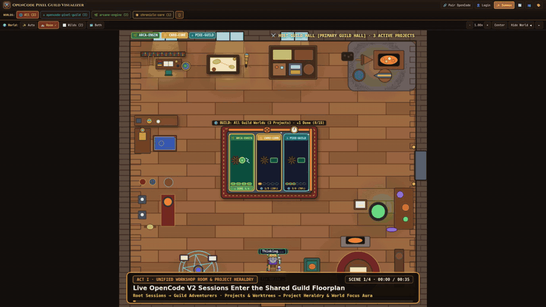

> **🎬 [Watch Full 1080p Introduction Video (`docs/video/opencode-pixel-guild-intro.mp4`)](./docs/video/opencode-pixel-guild-intro.mp4)**
 **✨ [Replay Interactive Tour Live (`/?demo=intro-tour`)](http://127.0.0.1:4310/?demo=intro-tour)**

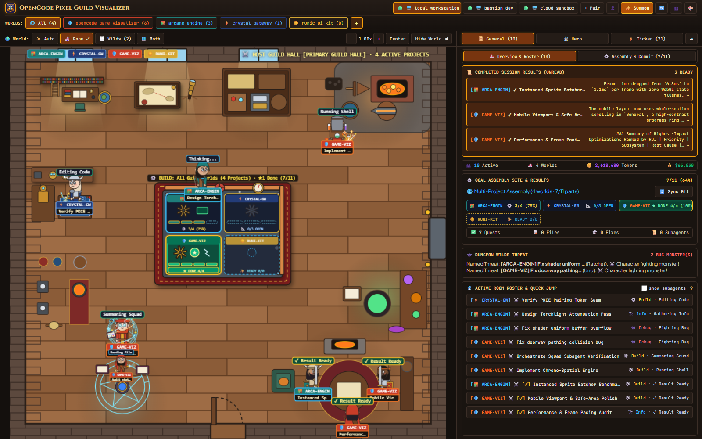

---

## Table of Contents

1. [What This App Does](#what-this-app-does)
2. [Visual Tour](#visual-tour)
3. [OpenCode V2 to Pixel Guild Mapping](#opencode-v2-to-pixel-guild-mapping)
4. [Guild Role Archetypes & Preparation Stations](#guild-role-archetypes--preparation-stations)
5. [How to Install & Run](#how-to-install--run)
   - [Option 1: Run with Docker Compose (Recommended)](#option-1-run-with-docker-compose-recommended)
   - [Option 2: Run Locally with Node.js 22+](#option-2-run-locally-with-nodejs-22)
   - [Environment Variables](#environment-variables)
   - [Agent Plugin & Skill Setup (`graphify`, `superpowers`, `mattpocock/skills`)](#agent-plugin--skill-setup-graphify-superpowers-mattpocockskills)
6. [How to Use the Visualizer](#how-to-use-the-visualizer)
   - [1. Register or Log In at the Operator Auth Gate](#1-register-or-log-in-at-the-operator-auth-gate)
   - [2. Pair Local or Remote OpenCode Machines](#2-pair-local-or-remote-opencode-machines)
   - [3. Navigate the Floorplan, Project Heraldry & Chamber Focus Modes](#3-navigate-the-floorplan-project-heraldry--chamber-focus-modes)
   - [4. Track Results & Commit Git Changes in the Guild Master Ledger](#4-track-results--commit-git-changes-in-the-guild-master-ledger)
   - [5. Inspect, Chat With & Steer Heroes in the Character Sheet](#5-inspect-chat-with--steer-heroes-in-the-character-sheet)
   - [6. Summon New Adventurers & Demolish Rooms](#6-summon-new-adventurers--demolish-rooms)
   - [7. Mobile & Home-Screen Web App Experience](#7-mobile--home-screen-web-app-experience)
7. [OpenCode Ecosystem & Disclaimer](#opencode-ecosystem--disclaimer)

---

## What This App Does

- **Unified Host Workshop Room with Project Heraldry**: All active OpenCode projects and Git worktrees on a paired machine share one **Workshop Room** and **Dungeon Wilds**, distinguished by project-colored uniforms, `[CREST TAG]` nameplates, and North Wall pennants.
- **Autonomous Character Choreography**: **Guild Adventurers** enter through the **South Swinging Guild Door**, walk along smooth floor paths, pace in contemplative circuits while thinking, haul **Resource Cargo** from the **Resource Stockpile**, and work at specialized **Preparation Stations**.
- **Outdoor Debugging Hunts & Monster Combat**: Debugging sessions venture into the **Dungeon Wilds**, cast **Lantern Flares** during searches to clear **Fog of War**, and fight their bound **Bug Monster** until tests pass.
- **Interactive Command & Git Control**: Prompt idle heroes, steer or stop active turns, switch **OpenCode Agent Modes** live, attach `@skill` grimoires, answer permission/question **Quest Gates**, and stage or commit Git changes in the **Assembly Commit Ledger**.

---

## Visual Tour

| Split Chamber View (`65%` Workshop Room / `35%` Dungeon Wilds) | Dungeon Wilds & Per-Bug Monster Combat |
| :---: | :---: |
| 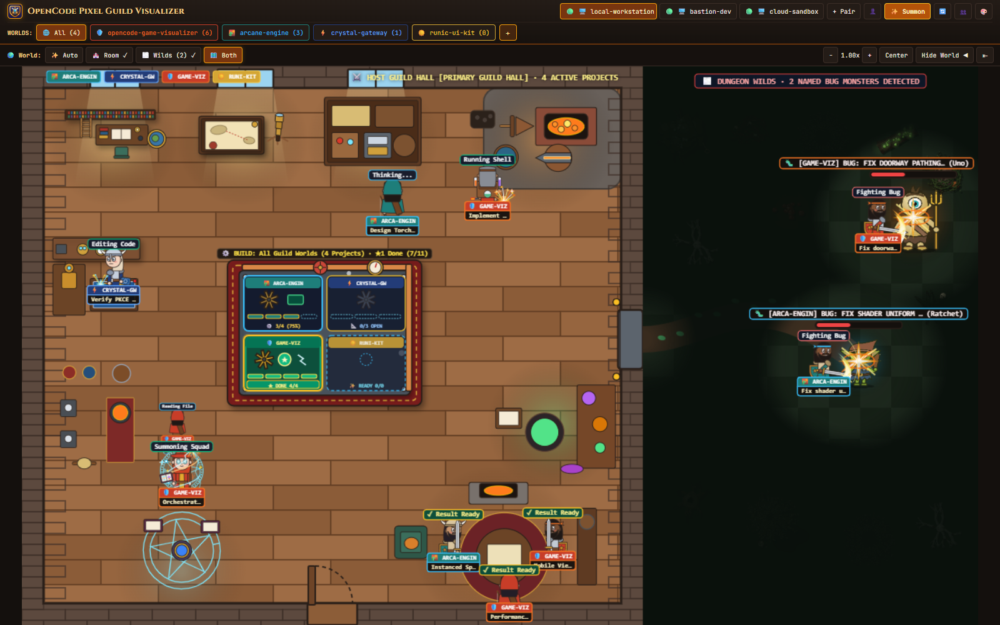 | 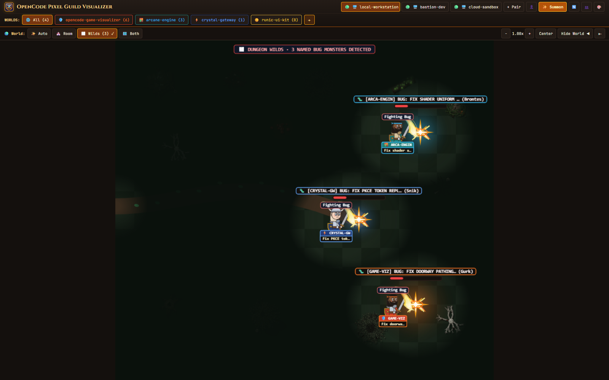 |
| **Character Sheet (`Chat` Dispatch Log & Result Review)** | **Assembly Commit Ledger (Interactive Git CRUD)** |
| 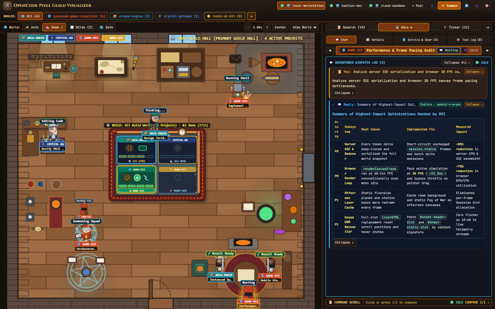 | 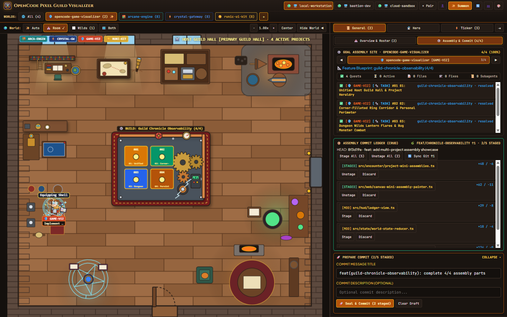 |
| **4-Scene Intro Tour (`/?demo=intro-tour` Full-Bleed Sizzle)** | **YouTube 1080p Master & Chapters** |
| 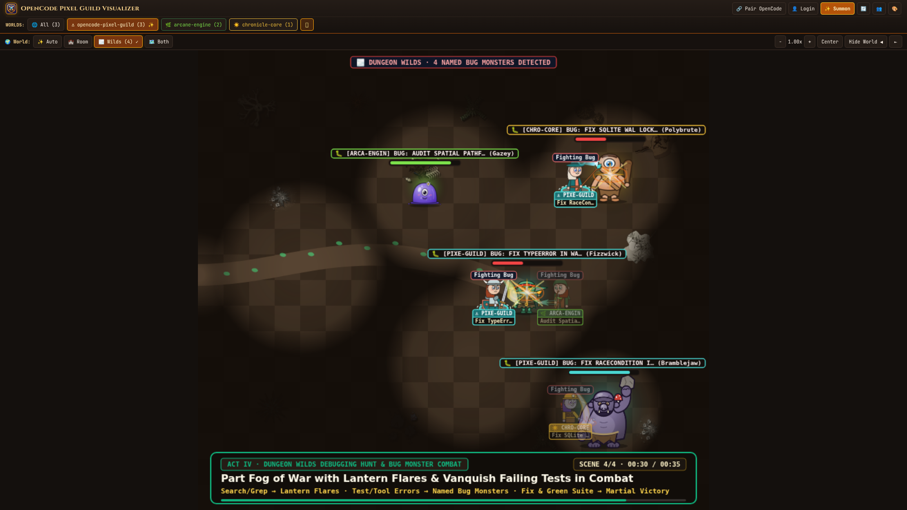 | [🎬 `opencode-pixel-guild-intro.mp4` (1080p 30 FPS)](./docs/video/opencode-pixel-guild-intro.mp4) · [📖 YouTube Chapters](./docs/video/youtube-publish-guide.md) |

---

## OpenCode V2 to Pixel Guild Mapping

| OpenCode V2 Concept | Pixel Guild Entity | How It Behaves in the World |
| :--- | :--- | :--- |
| **Paired OpenCode Host** | **Workshop Room** & **Dungeon Wilds** | One shared guild hall per host machine, switchable from the top header's machine strip. |
| **Project & Git Worktrees** | **Project Heraldry** & **World Focus Aura** | Characters wear project uniforms and `[CREST TAG]` badges; focusing a world highlights its heroes and dims others. |
| **Root Session** | **Guild Adventurer** | Primary 2D RPG hero outfitted according to its active **OpenCode Agent Mode** and **Guild Role Archetype**. |
| **Child Session** | **Squad Subagent** | Summoned at the **Arcane Lectern** pentagram by its parent adventurer, executes delegated tasks, and returns a **Report Scroll** on completion. |
| **Agent Profile** | **OpenCode Agent Mode** | Primary modes (`build`, `plan`, `document`, or custom) selectable on summon or switched live to change the hero's outfit. |
| **Tool Execution** | **Preparation Station** & **Work Implement** | Heroes walk to the matching station perimeter and wield the corresponding craft implement. |
| **Loaded Skill** (`@skill`) | **Skill Grimoire** | Equipped at the **Armory Wardrobe** and carried in the hero's off-hand across turns. |
| **MCP Servers & Plugins** | **Resource Stockpile** & **Resource Cargo** | North-wall supply depot where heroes pick up raw materials before heading to workstations. |
| **Feature Tasks & Modified Files** | **Goal Assembly Site** & **Project Mini-Assemblies** | Central platform showing per-project **Mini-Assemblies** in `🌐 All` mode or a full-scale assembly platform when a single project is focused. |
| **Debugging & Failing Tests** | **Dungeon Wilds**, **Lantern Flares** & **Bug Monsters** | Searches pulse **Lantern Flares** through **Fog of War**; fixes and test runs send heroes to fight their bound **Bug Monster**. |
| **Context Window & Compaction** | **Context Mana** & **Compaction Exhalation** | Context usage bar; compaction plays an in-place **Compaction Exhalation** (`Compacting...`) vapor cloud above the hero. |
| **Permissions & Questions** | **Quest Gate** (`!` Lock / `?` Question) | Overhead alert marker that pauses the hero and renders interactive approval or question choices in the **Character Sheet**. |
| **Completed Session Output** | **Unread Session Result** (`✓ Result Ready`) | Finished sessions rest in the **Break Lounge** with a `✓ Result Ready` badge and appear at the top of the **Guild Master Ledger** until viewed. |
| **User Prompt Dispatch** | **Command Scroll** | Prompt composer (`/` shortcut) for waking idle heroes, steering busy turns, attaching `@skill` grimoires, or stopping execution. |
| **Working-Tree Git Changes** | **Assembly Commit Ledger** | Built-in Git panel for inspecting diffs, staging or discarding files, syncing remotes, and sealing commits. |

---

## Guild Role Archetypes & Preparation Stations

### Six Guild Role Archetypes (RPG Jobs)

| Archetype | OpenCode Modes, Skills & Specialties | Combat Weapon Archetype (Dungeon Wilds) |
| :--- | :--- | :--- |
| **`WARRIOR`** | `build`, `implement`, `tdd`, `diagnosing-bugs`, and test/fix tasks | **Broadsword Cleave** with Heater Shield |
| **`MAGE`** | `general`, `document`, `wayfinder`, `domain-modeling`, and orchestration | **Crystal Staff Arcane Barrage** with Runic Sigil |
| **`SCOUT`** | `plan`, `explore`, `research`, `find-skills`, and reconnaissance | **Longbow Riser Grip** with Feathered Arrow Volley |
| **`ALCHEMIST`** | `prototype`, `codebase-design`, Code Mode (`execute`), and MCP synthesis | **Steel Dagger Viper Thrust** with Sonic Ring |
| **`CLERIC`** | `code-review`, `grilling`, `pr`, `report`, and QA verification | **Steel Dagger Viper Thrust** with Speed Streaks |
| **`SAPPER`** | `demolition`, `cleanup`, `prune`, and worktree/container teardown | **Overhead Miner's Pickaxe Slam** with Shockwave Ring |

### Indoor Preparation Stations & Fixtures

| Station / Fixture | Location in Workshop Room | Triggered By | Work Implement Held |
| :--- | :--- | :--- | :--- |
| **Library Study Bookshelf** | North-West Wall | `read`, `glob`, `grep`, `list`, `lsp` | Open Codex & Magnifying Loupe |
| **Observatory Spyglass** | North Wall | `websearch`, `webfetch`, external docs | Brass Spyglass Telescope & Compass |
| **Resource Stockpile** | North Wall | MCP calls, plugin tools, cargo pickup | Timber Planks, Stone Block, Iron Bar, Crystal, Scroll |
| **Anvil Forge** | North-East Corner | `bash` / shell commands, builds, tests | Blacksmith's Forge Hammer & Iron Tongs |
| **Crafting Workbench** | West Wall (Upper) | `edit`, `write`, `apply_patch` | Brass Machinist Spanner & Blueprint Board |
| **Armory Wardrobe** | West Wall (Lower) | First tool equip, `skill` tool, or `@skill` | Skill Grimoire & Equipment Loadout |
| **Arcane Lectern** | South-West Corner | `subagent` / `task` orchestration | Runic Summoning Tome & Pentagram Circle |
| **Alchemy Lab** | South-East Wall (Upper) | Refactoring, synthesis, `execute` | Wooden Stirring Ladle & Boiling Flask |
| **Break Lounge** | South-East Corner | Idle, resting, or completed sessions | Hearth Fireplace, Tavern Table & Armchair |
| **Goal Assembly Site** | Center of Room | Fitting **Assembly Parts** from deliverables | Blueprint Platform & Clockwork Gears |

---

## How to Install & Run

### Prerequisites

- **Docker Runtime (Recommended)**: **Docker** and **Docker Compose**.
- **Local Node.js Runtime**: **Node.js 22+** (runs TypeScript natively with zero external npm dependencies) and **Git**.

### Option 1: Run with Docker Compose (Recommended)

1. **Clone the repository:**
   ```bash
   git clone https://github.com/nirtus/opencode-pixel-guild.git
   cd opencode-pixel-guild
   ```

2. **Build and start the container on port `4310`:**
   ```bash
   npm run docker:up
   ```

3. **Open the visualizer in your browser:**
   Visit **[http://127.0.0.1:4310](http://127.0.0.1:4310)**.

4. **Manage the container:**
   ```bash
   docker ps --filter "name=opencode-pixel-guild-visualizer"
   npm run docker:logs
   npm run docker:down
   ```

### Option 2: Run Locally with Node.js 22+

```bash
# Start the server on http://127.0.0.1:4310
npm start

# Run the automated test suite
npm test

# Re-record the 1080p MP4 intro video and README animated GIF preview
npm run demo:video
```

### Environment Variables

| Variable | Default | Description |
| :--- | :--- | :--- |
| `PORT` | `4310` | HTTP port for the web UI, SSE stream, and REST API. |
| `HOST` | `0.0.0.0` | Network interface bind address. |
| `OPENCODE_SERVICE_URL` | *(auto-discovered)* | Explicit default URL for an OpenCode V2 daemon (e.g., `http://127.0.0.1:4096`). |
| `OPENCODE_SERVICE_PASSWORD` | *(empty)* | Optional password or bearer token for `OPENCODE_SERVICE_URL`. |
| `OPENCODE_SERVICE_FILE` | `~/.local/state/opencode/service.json` | Path to the local OpenCode service discovery file. |
| `OPENCODE_DAEMON_PORT` | `4096` | Default OpenCode daemon port used when resolving local pairing links inside Docker. |
| `OPENCODE_DOCKER_HOST` | `host.docker.internal` | Hostname used inside Docker to reach a daemon on the host machine. |

### Agent Plugin & Skill Setup (`graphify`, `superpowers`, `mattpocock/skills`)

To install, configure, and verify **`graphify`** (knowledge graph CLI, git hooks, and `docs/graphify-out/` AST index), **`superpowers`**, and **`mattpocock/skills` (all 27 engineering & productivity skills + `/setup-matt-pocock-skills`)** across OpenCode V2/V1 or any other coding agent harness, follow the portable 5-stage runbook in `docs/agents/plugin-setup.md`.

---

## How to Use the Visualizer

### 1. Register or Log In at the Operator Auth Gate

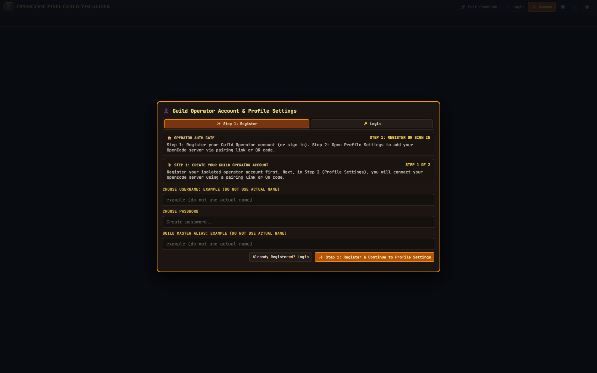

- Enter a **Username**, **Password**, and optional **Guild Master Alias**, then click **Step 1: Register & Continue to Profile Settings** (or switch to **Login**).
- Each operator account is persisted locally in `./data/` with isolated world state, preferences, and paired OpenCode machines.

---

### 2. Pair Local or Remote OpenCode Machines

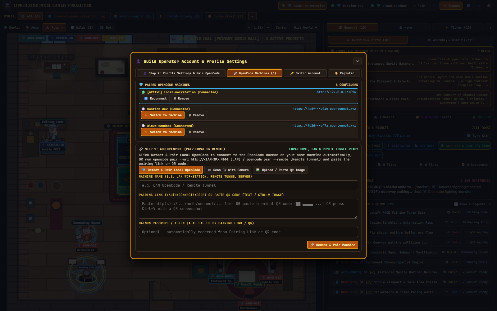

- Run `opencode pair --remote` (or `opencode pair --url http://<LAN-IP>:4096`) on your OpenCode host.
- In the **OpenCode Machines** tab (`+ Pair`), paste the pairing link/QR text, scan the QR code with your camera, or upload/paste a QR screenshot, then click **Redeem & Pair Machine**.
- Click any paired machine pill in the top header bar to switch your active **Workshop Room** to that host (isolating all **Workshop Rooms**, `0`-session registered worlds, **Guild Characters**, **OpenCode Agent Modes**, **Lifetime Tribute**, and **Goal Assembly Site** / **Assembly Commit Ledger** state to the selected machine), or click **Detect & Pair Local OpenCode** for local auto-discovery.

---

### 3. Navigate the Floorplan, Project Heraldry & Chamber Focus Modes

| `🌐 All` Worlds Selected (All-Worlds Game Master Aggregation) | Specific World Selected (Single-World Game Master Scope) |
| :---: | :---: |
| 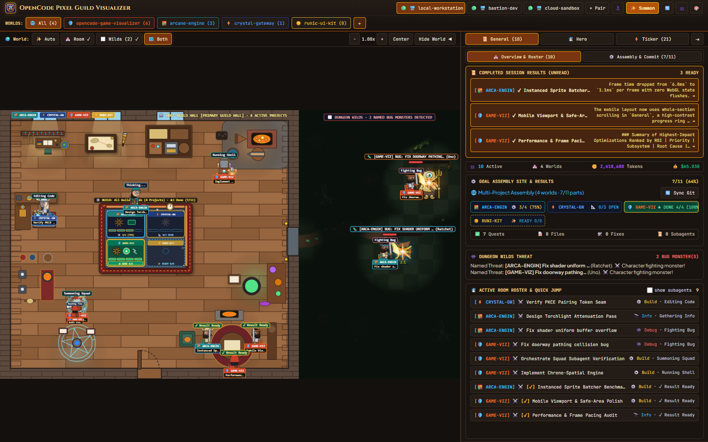 | 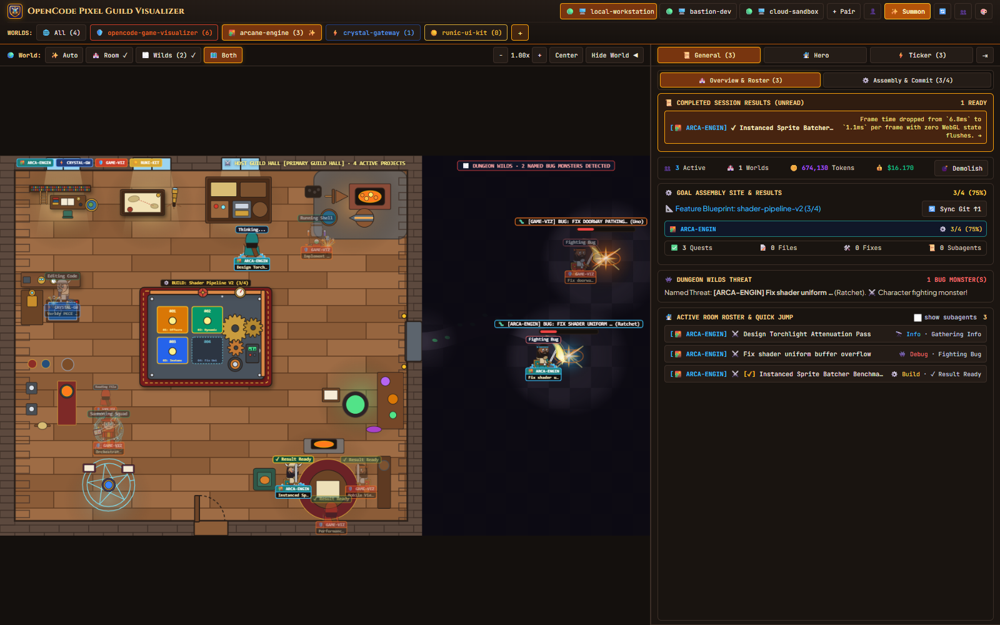 |

- **Project Worlds Bar (`Worlds:`)**: Select `🌐 All` to view all projects together with composite **Project Mini-Assemblies** (`★ DONE`, `⚙️ IN PROGRESS`, `📐 OPEN`, `✨ READY`), or click a project pill (e.g., `opencode-game-visualizer` or `arcane-engine`) to focus its heroes with an underfoot **World Focus Aura** and scope the **Spectator Drawer** to that project.
- **Add Project Worlds (`＋`)**: Click `＋` at the end of the `Worlds:` bar to browse workspace folders discovered directly on the currently active **OpenCode Machine Pairing**, register a folder as a new project world, or immediately summon an adventurer into it.
- **Chamber Focus (`World:` Toolbar)**: Switch between `Auto` (expands **Dungeon Wilds** automatically during outdoor bug hunts), `Room`, `Wilds`, and `Both` (`65% / 35%` split).
- **Camera & Layout Controls**: Drag to pan, scroll or click `-` / `+` to zoom, drag the vertical divider to resize the desktop split, or toggle `Hide World` / `⇥` to collapse either pane.

---

### 4. Track Results & Commit Git Changes in the Guild Master Ledger

Clicking empty floor space (or pressing `Escape`) opens the **Guild Master Ledger** (`General` tab):

#### `Overview & Roster` Subtab

- **Completed Session Results (Unread)**: Displays finished sessions waiting with `✓ Result Ready`; clicking any entry opens **Hero Chat** and marks the result as read.
- **Telemetry, Lifetime Tribute & Demolition**: Shows active hero count, world count, cumulative **Lifetime Tribute** (`🪙 Tokens` and `💰 Cost`), and—when a single world is focused—the **Demolish** button.
- **Goal Assembly & Active Room Roster**: Summarizes assembly progress with an inline **🔄 Sync Git** action, lists active **Bug Monsters**, and provides a quick-jump roster with a `show subagents` toggle.

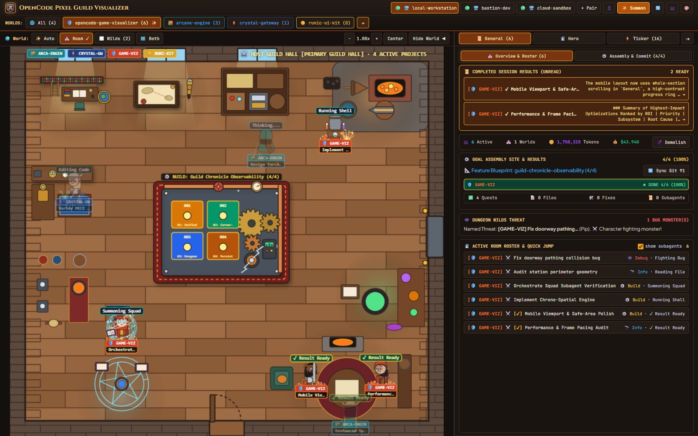

#### `Assembly & Commit` Subtab

| Project Repository Browser & Assembly Breakdown | Interactive Git Staging & Commit CRUD |
| :---: | :---: |
| 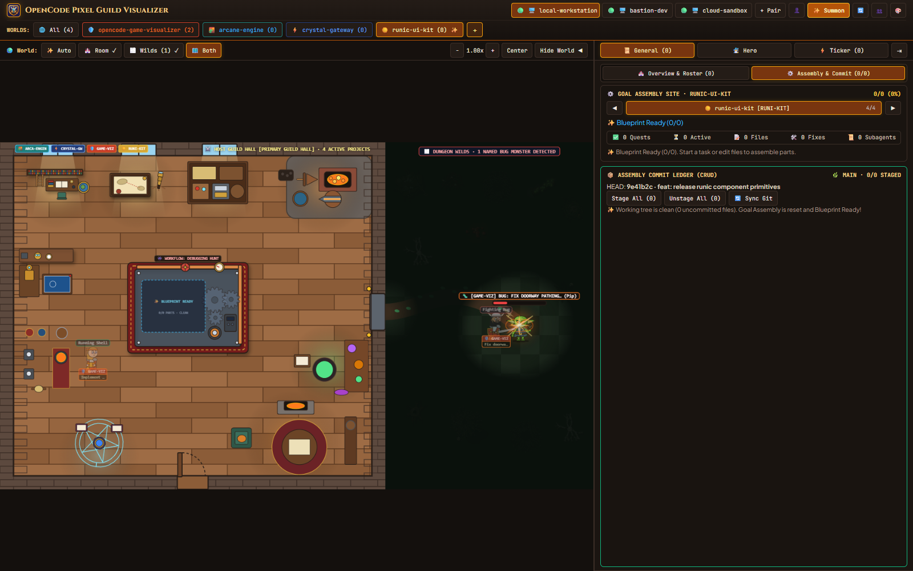 |  |

- Select a project repository using the single-row project switcher at the top of **Goal Assembly Site**.
- Inspect uncommitted working-tree files (`[STAGED]`, `[MOD]`, `[NEW]`), stage or unstage changes, discard edits, sync with upstream (`🔄 Sync Git`), and click **Seal & Commit** to commit changes and reset the assembly platform.

---

### 5. Inspect, Chat With & Steer Heroes in the Character Sheet

Click any hero on the canvas or in the roster to open their **Character Sheet** (`Hero` tab):

| `Scrolls & Gear` (Equipment Loadout & Grimoires) | `Tool Log` (Executed Tool & Shell History) |
| :---: | :---: |
| 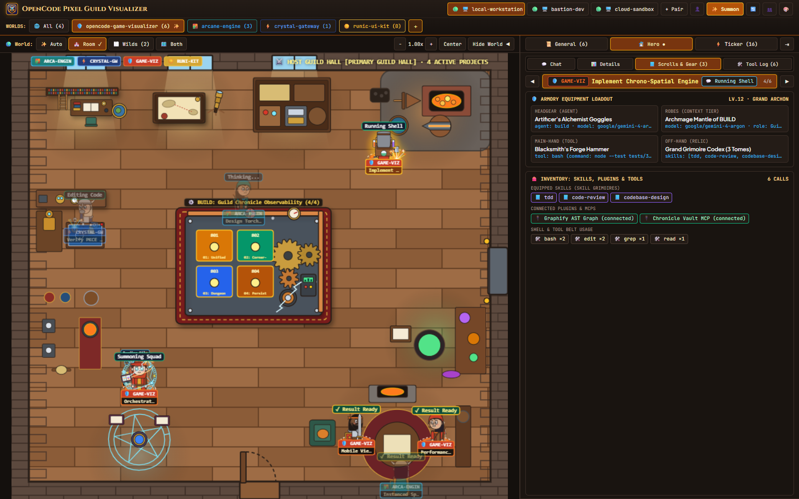 | 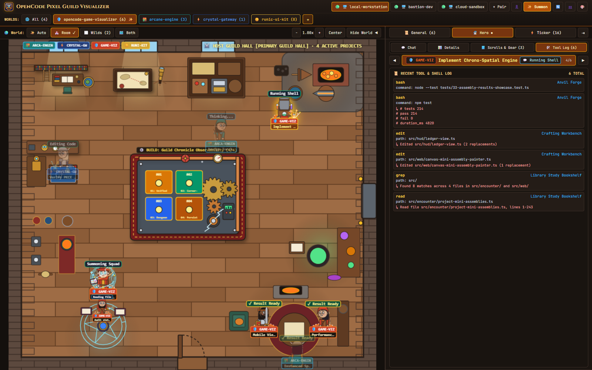 |

- **`Chat`**: Review the **Adventurer Dispatch Log** (collapsed into one-liners by default; click any row or `Expand All ▾` for full Markdown), resolve `!` Permission and `?` Question **Quest Gates** with clickable option pills, and open the bottom **Command Scroll** composer (`/` shortcut) to attach `@skill` badges, switch **OpenCode Agent Modes**, and steer or stop the hero.
- **`Details`**: Inspect session ID, model, **Context Mana** utilization (`used / limit` tokens), **Lifetime Tribute** cost, **Workflow Intent**, target station, and subagent lineage.
- **`Scrolls & Gear`**: View the hero's RPG **Equipment Loadout** (Headgear, Robes, Main-Hand Implement, Off-Hand Relic), equipped **Skill Grimoires**, connected MCP plugins, and tool belt counts.
- **`Tool Log`**: Browse the chronological history of executed tool and shell calls with input/output previews and station routing tags.

---

### 6. Summon New Adventurers & Demolish Rooms

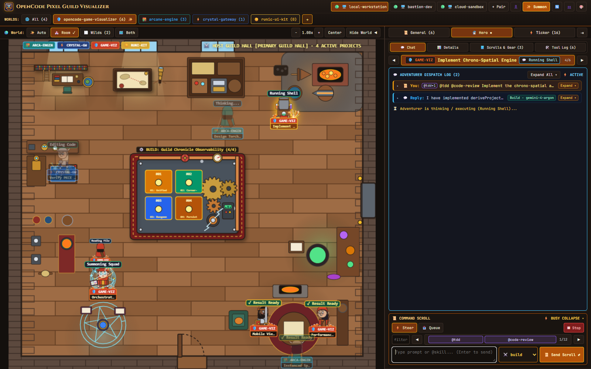

- **Summon an Adventurer (`✨ Summon`)**: Choose a target project directory, select an **OpenCode Agent Mode** (`build`, `plan`, `document`, or custom), optionally attach `@skill` badges from the **Available Skills Browser**, and send an opening prompt (or summon an idle hero) through the **South Swinging Guild Door**.
- **Demolish a Room (`Demolish`)**: When viewing a single project world in `Overview & Roster`, click **Demolish** and confirm to terminate its active sessions, PTYs, and worktree resources.

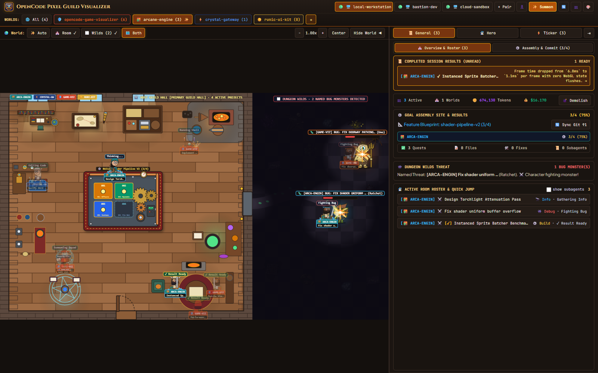

---

### 7. Mobile & Home-Screen Web App Experience

| Mobile Workshop Room (`World` Tab) | Mobile Dungeon Wilds Combat | Mobile Guild Master Ledger (`General` Tab) | Mobile Character Sheet (`Hero` Tab) |
| :---: | :---: | :---: | :---: |
| 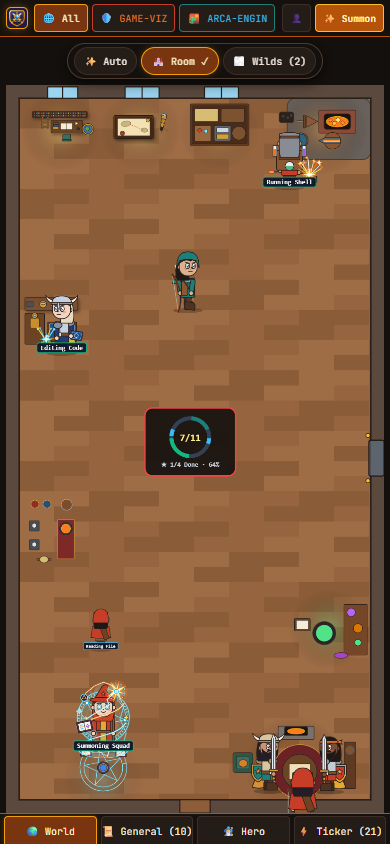 | 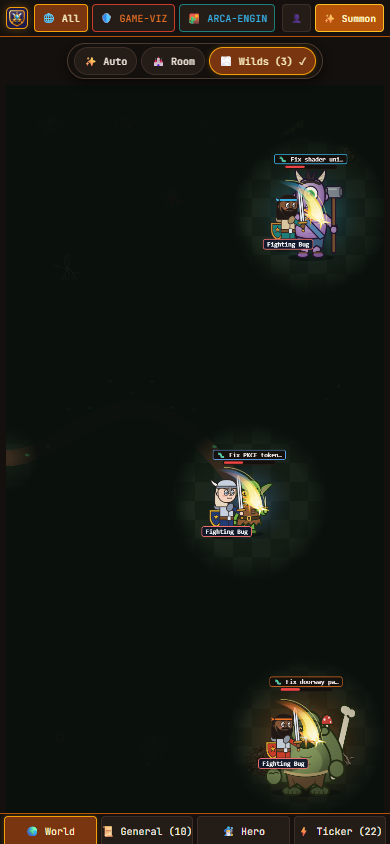 | 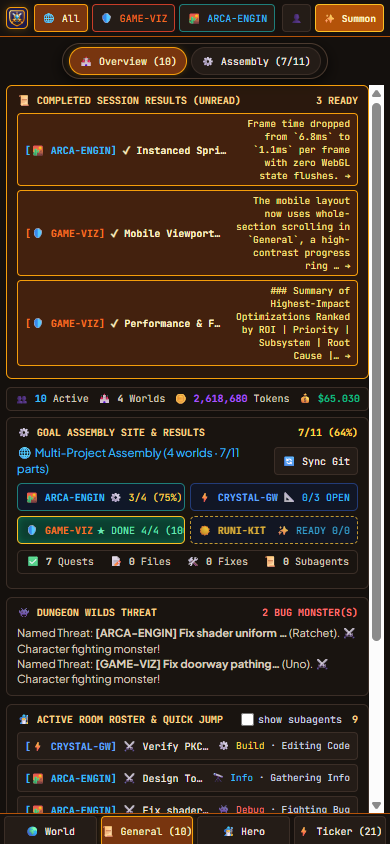 | 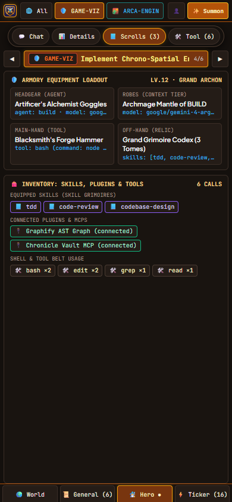 |

- **Bottom Navigation Bar**: Switch between `🌍 World`, `📜 General`, `🧙 Hero`, and `⚡ Ticker` with live badge counters and Quest Gate alert indicators.
- **Mobile-Adapted Floorplan & Drawer**: Simplifies the central **Goal Assembly Site** into a high-contrast progress ring on compact screens and scrolls the `General` ledger as a unified mobile page with full safe-area support.

---

## OpenCode Ecosystem & Disclaimer

- **Ecosystem & Directory Submissions**: See [`docs/awesome-opencode-submission.md`](./docs/awesome-opencode-submission.md) for the validated submission packages and live upstream submissions across [`awesome-opencode` PR #1043](https://github.com/awesome-opencode/awesome-opencode/pull/1043) & [Projects Discussion #1044](https://github.com/awesome-opencode/awesome-opencode/discussions/1044), the official [`anomalyco/opencode` Ecosystem PR #63949](https://github.com/anomalyco/opencode/pull/63949), [`opencode.cafe` PR #18](https://github.com/R44VC0RP/opencode.cafe/pull/18), and [`opencode-plugin-marketplace` PR #9](https://github.com/Tommertom/opencode-plugin-marketplace/pull/9).
- **Non-Affiliation Disclaimer**: *OpenCode Pixel Guild Visualizer (`opencode-pixel-guild`) is an independent, community-built project and is not built by or affiliated with the OpenCode or Anomaly team in any way.*
