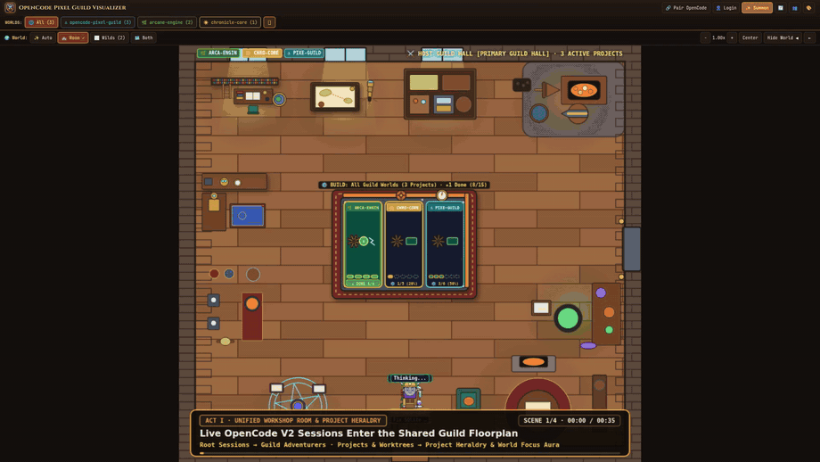

# OpenCode V2 Ecosystem, Registries & Directory Submission Runbook

This runbook contains the verified, schema-validated submission packages and one-command `gh` workflows for listing and showcasing **OpenCode Pixel Guild** (`https://github.com/nirtus/opencode-pixel-guild`) across every official and community OpenCode V2 directory:

1. **[`awesome-opencode/awesome-opencode`](https://github.com/awesome-opencode/awesome-opencode)** — `data/projects/opencode-pixel-guild.yaml` ([Live PR #1043](https://github.com/awesome-opencode/awesome-opencode/pull/1043)) + **`Projects` Discussions Showcase** (matching `OpenChamber` [#55](https://github.com/awesome-opencode/awesome-opencode/discussions/55) & `opencode-helper` [#460](https://github.com/awesome-opencode/awesome-opencode/discussions/460))
2. **[Official OpenCode Ecosystem Docs (`anomalyco/opencode`)](https://github.com/anomalyco/opencode/blob/dev/services/site/src/docs/v1/content/ecosystem.mdx)** — `services/site/src/docs/v1/content/ecosystem.mdx` (`## Projects` table on `dev` branch)
3. **[`opencode.cafe` (`R44VC0RP/opencode.cafe`)](https://github.com/R44VC0RP/opencode.cafe)** — `bulk/plugins.json` PR + [`opencode.cafe/submit`](https://www.opencode.cafe/submit) web form (also auto-syndicates into [`opencode-mercato`](https://github.com/ThomasSanna/opencode-mercato))
4. **[`Tommertom/opencode-plugin-marketplace`](https://github.com/Tommertom/opencode-plugin-marketplace)** — `plugins/opencode-pixel-guild.plugin.json` (validated against `schema/plugin.schema.json`)
5. **Community Channels** — Official OpenCode Discord (`https://opencode.ai/discord`), Reddit (`r/opencode`, `r/opencodeCLI`, `r/LocalLLaMA`), and Hacker News (`Show HN`)

---

## 0. Pre-Flight Compliance Check (`anomalyco/opencode`)

Per [`anomalyco/opencode#building-on-opencode`](https://github.com/anomalyco/opencode#building-on-opencode), any community project using `opencode` in its name must include a non-affiliation note in its `README.md`.

- **Status**: **Complete** — [`README.md` (`## OpenCode Ecosystem & Disclaimer`)](../README.md#opencode-ecosystem--disclaimer) includes the explicit non-affiliation disclaimer.

---

## 1. `awesome-opencode/awesome-opencode` (`data/projects/` PR & `Projects` Discussion Showcase)

- **Live Pull Request**: [`awesome-opencode/awesome-opencode#1043`](https://github.com/awesome-opencode/awesome-opencode/pull/1043)
- **Fork Branch & YAML File**: [`nirtus/awesome-opencode@add-opencode-pixel-guild` (`data/projects/opencode-pixel-guild.yaml`)](https://github.com/nirtus/awesome-opencode/blob/add-opencode-pixel-guild/data/projects/opencode-pixel-guild.yaml)
- **Projects Discussions Category**: [`https://github.com/awesome-opencode/awesome-opencode/discussions/categories/projects`](https://github.com/awesome-opencode/awesome-opencode/discussions/categories/projects)

### 1A. Entry Requirements Audit (`contributing.md`)

| # | `awesome-opencode` Rule | Requirement | Status for `nirtus/opencode-pixel-guild` |
| :- | :--- | :--- | :--- |
| **1** | **Format** | One valid YAML file (`kebab-case.yaml`) in `data/projects/`. Never edit `README.md` (auto-generated). | **Submitted in [PR #1043](https://github.com/awesome-opencode/awesome-opencode/pull/1043)** — passes `data/schema.json` validation. |
| **2** | **Relevant** | OpenCode is a real, documented target with setup docs, and `description` states OpenCode major version support (`OpenCode V2`). | **Ready** — `README.md` documents Docker Compose, Node.js 22+, `opencode pair`, and local daemon auto-discovery for **OpenCode V2**. |
| **3** | **Public** | Repository is public (`MIT`) with working clone/setup links and no dead URLs. | **Ready** — `https://github.com/nirtus/opencode-pixel-guild` is public (`MIT`). |
| **4** | **Maintained** | Not archived and has a commit in the last 90 days. | **Ready** — Actively maintained. |
| **5** | **Traction** | **At least 25 stars, and the repo is at least 30 days old.** | **In Progress** — Post in `awesome-opencode` Discussions (`Projects`) and community channels to build stars while [PR #1043](https://github.com/awesome-opencode/awesome-opencode/pull/1043) is open. |
| **6** | **Unique** | Not already in the list and clearly distinct from existing entries. | **Ready** — Placed in `data/projects/` and clearly distinguished from `psinetron/opencode-visualiser` (`data/plugins/`). |
| **7** | **Complete** | All required fields (`name`, `repo`, `tagline`, `description`) present and `tagline` ≤ 120 characters. | **Ready** — Tagline is **111 characters** (`≤ 120`). |

### 1B. `awesome-opencode` Discussions Showcase (`Projects` Category)

On `awesome-opencode`, established projects such as **OpenChamber** ([Discussion #55](https://github.com/awesome-opencode/awesome-opencode/discussions/55), labelled `Added`), **Kimaki** ([Discussion #18](https://github.com/awesome-opencode/awesome-opencode/discussions/18), labelled `Added`), **opencode.nvim** ([Discussion #16](https://github.com/awesome-opencode/awesome-opencode/discussions/16), labelled `Added`), and **opencode-helper** ([Discussion #460](https://github.com/awesome-opencode/awesome-opencode/discussions/460)) post a concise showcase thread in [**Discussions › Projects**](https://github.com/awesome-opencode/awesome-opencode/discussions/categories/projects) with an inline visual preview, feature bullet points, and a link to their PR.

#### Ready-to-Post Discussion Title & Body
- **Category**: `Projects` (*"Share any Projects or nominate them to the list"*)
- **Title**: `OpenCode Pixel Guild — 2D RPG workshop & dungeon visualizer for live OpenCode V2 sessions`
- **Body**:
  ```markdown
  Hi everyone 👋

  I'd like to share **[OpenCode Pixel Guild](https://github.com/nirtus/opencode-pixel-guild)** — a self-hosted 2D RPG workshop and dungeon companion built for **OpenCode V2**.

  

  ## What it does
  - **Unified Host Workshop Room & Project Heraldry** — Pairs with local or remote OpenCode V2 daemons (`opencode pair` QR/URL redemption or local auto-discovery) and renders all active projects and git worktrees inside a shared Workshop Room with deterministic guild uniforms and crests.
  - **Autonomous Session & Subagent Choreography** — Root sessions (**Guild Adventurers**) and child subagents (**Squad Subagents**) walk between 10 tool-specific preparation stations, equip `@skill` grimoires at the Armory Wardrobe, haul MCP cargo from the Resource Stockpile, and perform subagent summoning rituals at the Arcane Lectern.
  - **Outdoor Debugging & Bug Monster Combat** — Diagnostic searches pulse **Lantern Flares** through **Fog of War** in the **Dungeon Wilds**, and failing test/debug turns engage per-bug **Bug Monsters** until tests pass.
  - **Bi-Directional Control & Git CRUD** — Summon heroes, switch OpenCode Agent Modes (`build`, `plan`, `document`) live, answer permission and question prompts, and stage/commit/sync Git changes in the built-in **Assembly Commit Ledger** from desktop or mobile.
  - **Zero External npm Dependencies** — Runs natively on Node.js 22+ (`npm start`) or Docker Compose (`npm run docker:up`).

  ## PR
  I've opened **[PR #1043](https://github.com/awesome-opencode/awesome-opencode/pull/1043)** (`data/projects/opencode-pixel-guild.yaml`) to add it to the projects list. Feedback and suggestions are very welcome!
  ```

#### One-Command `gh api graphql` Script to Publish the Discussion
```bash
# Query repository ID and "Projects" discussion category ID on awesome-opencode/awesome-opencode, then create the discussion:
REPO_DATA=$(gh api graphql -f query='
  query {
    repository(owner: "awesome-opencode", name: "awesome-opencode") {
      id
      discussionCategories(first: 20) {
        nodes { id name slug }
      }
    }
  }
')
REPO_ID=$(echo "$REPO_DATA" | node -e 'const d=JSON.parse(require("fs").readFileSync(0,"utf8")); console.log(d.data.repository.id)')
CAT_ID=$(echo "$REPO_DATA" | node -e 'const d=JSON.parse(require("fs").readFileSync(0,"utf8")); console.log(d.data.repository.discussionCategories.nodes.find(n=>n.slug==="projects").id)')

gh api graphql \
  -f repositoryId="$REPO_ID" \
  -f categoryId="$CAT_ID" \
  -f title="OpenCode Pixel Guild — 2D RPG workshop & dungeon visualizer for live OpenCode V2 sessions" \
  -f body="$(cat << 'EOF'
Hi everyone 👋

I'd like to share **[OpenCode Pixel Guild](https://github.com/nirtus/opencode-pixel-guild)** — a self-hosted 2D RPG workshop and dungeon companion built for **OpenCode V2**.


## What it does
- **Unified Host Workshop Room & Project Heraldry** — Pairs with local or remote OpenCode V2 daemons (`opencode pair` QR/URL redemption or local auto-discovery) and renders all active projects and git worktrees inside a shared Workshop Room with deterministic guild uniforms and crests.
- **Autonomous Session & Subagent Choreography** — Root sessions (**Guild Adventurers**) and child subagents (**Squad Subagents**) walk between 10 tool-specific preparation stations, equip `@skill` grimoires at the Armory Wardrobe, haul MCP cargo from the Resource Stockpile, and perform subagent summoning rituals at the Arcane Lectern.
- **Outdoor Debugging & Bug Monster Combat** — Diagnostic searches pulse **Lantern Flares** through **Fog of War** in the **Dungeon Wilds**, and failing test/debug turns engage per-bug **Bug Monsters** until tests pass.
- **Bi-Directional Control & Git CRUD** — Summon heroes, switch OpenCode Agent Modes (`build`, `plan`, `document`) live, answer permission and question prompts, and stage/commit/sync Git changes in the built-in **Assembly Commit Ledger** from desktop or mobile.
- **Zero External npm Dependencies** — Runs natively on Node.js 22+ (`npm start`) or Docker Compose (`npm run docker:up`).

## PR
I've opened **[PR #1043](https://github.com/awesome-opencode/awesome-opencode/pull/1043)** (`data/projects/opencode-pixel-guild.yaml`) to add it to the projects list. Feedback and suggestions are very welcome!
EOF
)" \
  -f query='
    mutation($repositoryId: ID!, $categoryId: ID!, $title: String!, $body: String!) {
      createDiscussion(input: {repositoryId: $repositoryId, categoryId: $categoryId, title: $title, body: $body}) {
        discussion { url }
      }
    }
  '
```

---

## 2. Official OpenCode Ecosystem Page (`anomalyco/opencode`)

- **Live Page**: [`https://opencode.ai/docs/ecosystem`](https://opencode.ai/docs/ecosystem)
- **Repository & Target Branch**: [`anomalyco/opencode`](https://github.com/anomalyco/opencode) (`dev` branch)
- **Exact File Path**: [`services/site/src/docs/v1/content/ecosystem.mdx`](https://github.com/anomalyco/opencode/blob/dev/services/site/src/docs/v1/content/ecosystem.mdx)
- **Target Section**: `## Projects` table (alongside `kimaki`, `portal`, `OpenChamber`, `OpenWork`, and `CodeNomad`)

### Exact Table Row Addition (`services/site/src/docs/v1/content/ecosystem.mdx`)

Append one row to the `## Projects` table (matching the exact 90-character Name column width and 64-character Description header alignment):

```markdown
| [opencode-pixel-guild](https://github.com/nirtus/opencode-pixel-guild)                     | 2D RPG workshop and dungeon visualizer for live OpenCode sessions |
```

### One-Command `gh` Fork, Commit & PR Script (`anomalyco/opencode`)

```bash
# 1. Fork anomalyco/opencode (if not already forked)
gh repo fork anomalyco/opencode --clone=false

# 2. Fetch current services/site/src/docs/v1/content/ecosystem.mdx from anomalyco/opencode@dev,
#    create branch docs/add-opencode-pixel-guild on nirtus/opencode, and commit the row via GitHub API:
BASE_SHA=$(gh api repos/anomalyco/opencode/git/ref/heads/dev --jq '.object.sha')
gh api repos/nirtus/opencode/git/refs -f ref="refs/heads/docs/add-opencode-pixel-guild" -f sha="$BASE_SHA" || true

FILE_JSON=$(gh api "repos/anomalyco/opencode/contents/services/site/src/docs/v1/content/ecosystem.mdx?ref=dev")
FILE_SHA=$(echo "$FILE_JSON" | node -e 'console.log(JSON.parse(require("fs").readFileSync(0,"utf8")).sha)')
UPDATED_B64=$(echo "$FILE_JSON" | node -e '
  const data = JSON.parse(require("fs").readFileSync(0, "utf8"));
  const content = Buffer.from(data.content, "base64").toString("utf8");
  const target = "| [CodeNomad](https://github.com/NeuralNomadsAI/CodeNomad)                                   | Desktop, Web, Mobile and Remote Client App for OpenCode          |";
  const row = "| [opencode-pixel-guild](https://github.com/nirtus/opencode-pixel-guild)                     | 2D RPG workshop and dungeon visualizer for live OpenCode sessions |";
  const next = content.includes("opencode-pixel-guild") ? content : content.replace(target, target + "\n" + row);
  process.stdout.write(Buffer.from(next, "utf8").toString("base64"));
')

gh api --method PUT repos/nirtus/opencode/contents/services/site/src/docs/v1/content/ecosystem.mdx \
  -f message="docs: add opencode-pixel-guild to ecosystem projects" \
  -f content="$UPDATED_B64" \
  -f sha="$FILE_SHA" \
  -f branch="docs/add-opencode-pixel-guild"

# 3. Open the Pull Request against anomalyco:dev
gh pr create \
  --repo anomalyco/opencode \
  --base dev \
  --head nirtus:docs/add-opencode-pixel-guild \
  --title "docs: add opencode-pixel-guild to ecosystem projects" \
  --body "$(cat << 'EOF'
### Issue for this PR

N/A - docs-only addition to the community ecosystem page.

### Description

Adds [opencode-pixel-guild](https://github.com/nirtus/opencode-pixel-guild) to the **Projects** table in `services/site/src/docs/v1/content/ecosystem.mdx`.

`opencode-pixel-guild` is an open-source (MIT) 2D RPG workshop and dungeon web companion for OpenCode that connects to local or remote OpenCode daemons (`opencode pair` or service auto-discovery) and visualizes live sessions, subagents, tool calls, and Git working-tree changes. The repository README includes the required non-affiliation disclaimer.

### Type of change

- [ ] Bug fix (non-breaking change which fixes an issue)
- [ ] New feature (non-breaking change which adds functionality)
- [ ] Breaking change (fix or feature that would cause existing functionality to not work as expected)
- [x] Documentation (adds or updates documentation)
EOF
)"
```

---

## 3. `opencode.cafe` (`R44VC0RP/opencode.cafe` + `opencode-mercato` Auto-Syndication)

- **Live Directory**: [`https://www.opencode.cafe`](https://www.opencode.cafe) (officially linked at the top of `opencode.ai/docs/ecosystem`)
- **Web Submission Form**: [`https://www.opencode.cafe/submit`](https://www.opencode.cafe/submit)
- **GitHub Repository**: [`https://github.com/R44VC0RP/opencode.cafe`](https://github.com/R44VC0RP/opencode.cafe) (`bulk/plugins.json`)
- **Bonus Downstream Syndication**: [`ThomasSanna/opencode-mercato`](https://github.com/ThomasSanna/opencode-mercato) (the OpenCode V2 TUI marketplace) automatically ingests entries from `opencode.cafe`, `awesome-opencode`, and `ecosystem.mdx`.

### 3A. JSON Entry for `bulk/plugins.json` (and Web Form Fields)

```json
{
  "productId": "opencode-pixel-guild",
  "type": "tool",
  "displayName": "OpenCode Pixel Guild",
  "description": "Real-time 2D RPG workshop and dungeon visualizer for live OpenCode V2 sessions, subagents, tool calls, and Git commits",
  "repoUrl": "https://github.com/nirtus/opencode-pixel-guild",
  "homepageUrl": "https://github.com/nirtus/opencode-pixel-guild",
  "tags": ["visualizer", "web-ui", "rpg", "gamification", "subagents", "git"],
  "installation": "## Installation\n\nRun with Docker Compose (recommended):\n\n```bash\ngit clone https://github.com/nirtus/opencode-pixel-guild.git\ncd opencode-pixel-guild\nnpm run docker:up\n```\n\nOr run locally with Node.js 22+ (zero external npm dependencies):\n\n```bash\nnpm start\n```\n\nOpen `http://127.0.0.1:4310` in your browser and pair your local or remote OpenCode daemon via `opencode pair`."
}
```

### 3B. One-Command `gh` Fork, Commit & PR Script (`R44VC0RP/opencode.cafe`)

```bash
gh repo fork R44VC0RP/opencode.cafe --clone=false

BASE_SHA=$(gh api repos/R44VC0RP/opencode.cafe/git/ref/heads/main --jq '.object.sha')
gh api repos/nirtus/opencode.cafe/git/refs -f ref="refs/heads/add-opencode-pixel-guild" -f sha="$BASE_SHA" || true

FILE_JSON=$(gh api "repos/R44VC0RP/opencode.cafe/contents/bulk/plugins.json?ref=main")
FILE_SHA=$(echo "$FILE_JSON" | node -e 'console.log(JSON.parse(require("fs").readFileSync(0,"utf8")).sha)')
UPDATED_B64=$(echo "$FILE_JSON" | node -e '
  const data = JSON.parse(require("fs").readFileSync(0, "utf8"));
  const list = JSON.parse(Buffer.from(data.content, "base64").toString("utf8"));
  if (!list.some(item => item.productId === "opencode-pixel-guild")) {
    list.push({
      productId: "opencode-pixel-guild",
      type: "tool",
      displayName: "OpenCode Pixel Guild",
      description: "Real-time 2D RPG workshop and dungeon visualizer for live OpenCode V2 sessions, subagents, tool calls, and Git commits",
      repoUrl: "https://github.com/nirtus/opencode-pixel-guild",
      homepageUrl: "https://github.com/nirtus/opencode-pixel-guild",
      tags: ["visualizer", "web-ui", "rpg", "gamification", "subagents", "git"],
      installation: "## Installation\n\nRun with Docker Compose (recommended):\n\n```bash\ngit clone https://github.com/nirtus/opencode-pixel-guild.git\ncd opencode-pixel-guild\nnpm run docker:up\n```\n\nOr run locally with Node.js 22+ (zero external npm dependencies):\n\n```bash\nnpm start\n```\n\nOpen `http://127.0.0.1:4310` in your browser and pair your local or remote OpenCode daemon via `opencode pair`."
    });
  }
  process.stdout.write(Buffer.from(JSON.stringify(list, null, 2) + "\n", "utf8").toString("base64"));
')

gh api --method PUT repos/nirtus/opencode.cafe/contents/bulk/plugins.json \
  -f message="feat: add OpenCode Pixel Guild to bulk/plugins.json" \
  -f content="$UPDATED_B64" \
  -f sha="$FILE_SHA" \
  -f branch="add-opencode-pixel-guild"

gh pr create \
  --repo R44VC0RP/opencode.cafe \
  --base main \
  --head nirtus:add-opencode-pixel-guild \
  --title "feat: add OpenCode Pixel Guild" \
  --body "Adds **OpenCode Pixel Guild** (\`https://github.com/nirtus/opencode-pixel-guild\`), a real-time 2D RPG workshop and dungeon companion visualizer for live OpenCode V2 sessions, subagents, tools, and Git commits."
```

---

## 4. `Tommertom/opencode-plugin-marketplace` (`opencode-plugin-market.web.app`)

- **Live Website**: [`https://opencode-plugin-market.web.app`](https://opencode-plugin-market.web.app)
- **Repository**: [`https://github.com/Tommertom/opencode-plugin-marketplace`](https://github.com/Tommertom/opencode-plugin-marketplace)
- **Exact File Path**: `plugins/opencode-pixel-guild.plugin.json` (validated against [`schema/plugin.schema.json`](https://github.com/Tommertom/opencode-plugin-marketplace/blob/main/schema/plugin.schema.json))

### 4A. Schema-Validated `plugins/opencode-pixel-guild.plugin.json`

```json
{
  "name": "opencode-pixel-guild",
  "displayName": "OpenCode Pixel Guild",
  "description": "Real-time 2D RPG workshop and dungeon visualizer for live OpenCode V2 sessions, subagents, tool calls, and Git commits.",
  "categories": ["UI/UX", "Productivity", "Development", "Debugging"],
  "authors": [
    {
      "name": "nirtus",
      "url": "https://github.com/nirtus"
    }
  ],
  "license": "MIT",
  "links": {
    "repository": "https://github.com/nirtus/opencode-pixel-guild",
    "homepage": "https://github.com/nirtus/opencode-pixel-guild",
    "documentation": "https://github.com/nirtus/opencode-pixel-guild#readme"
  },
  "opencode": {
    "minimumVersion": "1.0.0"
  },
  "installation": {
    "summary": "Run with Docker Compose (npm run docker:up) or Node.js 22+ (npm start) on port 4310 and pair via opencode pair.",
    "markdown": "## Installation\n\n### Option 1: Docker Compose (Recommended)\n\n```bash\ngit clone https://github.com/nirtus/opencode-pixel-guild.git\ncd opencode-pixel-guild\nnpm run docker:up\n```\n\n### Option 2: Node.js 22+ (Zero External Dependencies)\n\n```bash\ngit clone https://github.com/nirtus/opencode-pixel-guild.git\ncd opencode-pixel-guild\nnpm start\n```\n\nOpen `http://127.0.0.1:4310` in your browser and pair your local or remote OpenCode V2 host."
  },
  "usage": {
    "markdown": "Pair local or remote OpenCode V2 machines using `opencode pair --remote` (QR scanner or link) or click **Detect & Pair Local OpenCode**. Watch root sessions and subagents craft features at indoor preparation stations, fight Bug Monsters in the Dungeon Wilds during failing test/debug turns, and manage prompts, permissions, questions, and Git commits from desktop or mobile."
  },
  "maintained": true,
  "lastUpdated": "2026-11-14",
  "installableFromMarketplace": false
}
```

### 4B. One-Command `gh` Fork, Commit & PR Script (`Tommertom/opencode-plugin-marketplace`)

```bash
gh repo fork Tommertom/opencode-plugin-marketplace --clone=false

BASE_SHA=$(gh api repos/Tommertom/opencode-plugin-marketplace/git/ref/heads/main --jq '.object.sha')
gh api repos/nirtus/opencode-plugin-marketplace/git/refs -f ref="refs/heads/add-opencode-pixel-guild" -f sha="$BASE_SHA" || true

PLUGIN_B64=$(cat << 'EOF' | base64 -w0
{
  "name": "opencode-pixel-guild",
  "displayName": "OpenCode Pixel Guild",
  "description": "Real-time 2D RPG workshop and dungeon visualizer for live OpenCode V2 sessions, subagents, tool calls, and Git commits.",
  "categories": ["UI/UX", "Productivity", "Development", "Debugging"],
  "authors": [
    {
      "name": "nirtus",
      "url": "https://github.com/nirtus"
    }
  ],
  "license": "MIT",
  "links": {
    "repository": "https://github.com/nirtus/opencode-pixel-guild",
    "homepage": "https://github.com/nirtus/opencode-pixel-guild",
    "documentation": "https://github.com/nirtus/opencode-pixel-guild#readme"
  },
  "opencode": {
    "minimumVersion": "1.0.0"
  },
  "installation": {
    "summary": "Run with Docker Compose (npm run docker:up) or Node.js 22+ (npm start) on port 4310 and pair via opencode pair.",
    "markdown": "## Installation\n\n### Option 1: Docker Compose (Recommended)\n\n```bash\ngit clone https://github.com/nirtus/opencode-pixel-guild.git\ncd opencode-pixel-guild\nnpm run docker:up\n```\n\n### Option 2: Node.js 22+ (Zero External Dependencies)\n\n```bash\ngit clone https://github.com/nirtus/opencode-pixel-guild.git\ncd opencode-pixel-guild\nnpm start\n```\n\nOpen `http://127.0.0.1:4310` in your browser and pair your local or remote OpenCode V2 host."
  },
  "usage": {
    "markdown": "Pair local or remote OpenCode V2 machines using `opencode pair --remote` (QR scanner or link) or click **Detect & Pair Local OpenCode**. Watch root sessions and subagents craft features at indoor preparation stations, fight Bug Monsters in the Dungeon Wilds during failing test/debug turns, and manage prompts, permissions, questions, and Git commits from desktop or mobile."
  },
  "maintained": true,
  "lastUpdated": "2026-11-14",
  "installableFromMarketplace": false
}
EOF
)

gh api --method PUT repos/nirtus/opencode-plugin-marketplace/contents/plugins/opencode-pixel-guild.plugin.json \
  -f message="Add OpenCode Pixel Guild" \
  -f content="$PLUGIN_B64" \
  -f branch="add-opencode-pixel-guild"

gh pr create \
  --repo Tommertom/opencode-plugin-marketplace \
  --base main \
  --head nirtus:add-opencode-pixel-guild \
  --title "Add OpenCode Pixel Guild" \
  --body "Adds **OpenCode Pixel Guild** (\`plugins/opencode-pixel-guild.plugin.json\`), a real-time 2D RPG workshop and dungeon companion visualizer for live OpenCode V2 sessions, subagents, tools, and Git commits."
```

---

## 5. Community Launch Channels (Discord, Reddit & Hacker News)

1. **Official OpenCode Discord (`https://opencode.ai/discord`)**:
   - Post `docs/images/opencode-pixel-guild-intro-preview.gif` or `docs/video/opencode-pixel-guild-intro.mp4` with the GitHub link (`https://github.com/nirtus/opencode-pixel-guild`) and `awesome-opencode` Discussion/PR links.
2. **Reddit ([`r/opencode`](https://www.reddit.com/r/opencode/), [`r/opencodeCLI`](https://www.reddit.com/r/opencodeCLI/), [`r/LocalLLaMA`](https://www.reddit.com/r/LocalLLaMA/))**:
   - **Title**: `I built OpenCode Pixel Guild — a real-time 2D RPG workshop & dungeon visualizer for live OpenCode V2 sessions and subagents (zero dependencies, MIT)`
   - **Media**: Upload `docs/video/opencode-pixel-guild-intro.mp4` (or `docs/images/opencode-pixel-guild-intro-preview.gif`)
3. **Hacker News (`https://news.ycombinator.com/submit`)**:
   - **Title**: `Show HN: OpenCode Pixel Guild – 2D RPG workshop and dungeon visualizer for OpenCode V2`
   - **URL**: `https://github.com/nirtus/opencode-pixel-guild`
