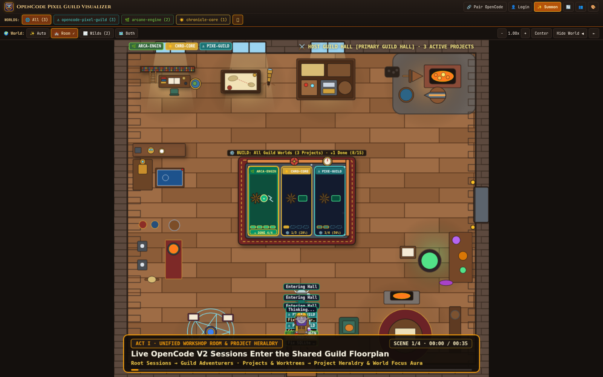

# Specification: Paired Machine Switch Leak Prevention & Authoritative Daemon Room Reconciliation

Label: ready-for-agent
Status: resolved

## Problem Statement

When a **Guild Operator** pairs multiple OpenCode machines (**OpenCode Machine Pairing**) and switches between them using the header machine switcher or Profile Settings modal, project worlds (**Workshop Rooms**), **Guild Characters**, **Lifetime Tribute** token/cost records, and **Goal Assembly Site** / **Assembly Commit Ledger** states from one paired machine leak into another paired machine. Once leaked, those foreign project rooms are persisted into the target machine's **Guild Chronicle Store** snapshot row and permanently reappear on every subsequent machine switch or server restart.

Root-cause diagnosis identified five interacting mechanisms causing this cross-machine project leakage:

1. **The 1.2-Second `saveTimer` Snapshot Poisoning Race During Machine Switch**:
   - At the start of `pairDaemon(targetUrl)` when switching from Machine A to Machine B, the runtime immediately mutates `profile.daemonUrl = cleanUrl` (Machine B) and dispatches `adapter.switched` with `daemonUrl: cleanUrl` onto the active world reducer **before** resetting the reducer and **before** `clientAdapter.start()` completes its remote network sweep of Machine B.
   - Dispatching `adapter.switched` triggers the reducer's subscription listener, which schedules a `1200ms` debounced `saveSnapshot(getStoreKey(), reducer.getSnapshot())`.
   - Because sweeping a remote OpenCode machine over an OpenTunnel or LAN connection routinely takes `1.5–5+` seconds, the `1200ms` timer fires while `reducer.getSnapshot()` **still holds all of Machine A's rooms, characters, and tribute ledger**, but `getStoreKey()` already resolves to Machine B's composite storage key (`operatorId@@machineB_url`). This writes Machine A's entire world snapshot and **Lifetime Tribute** rows directly into SQLite under Machine B's storage key, and broadcasts Machine A's rooms stamped with Machine B's `daemonUrl` to connected SSE clients.
2. **Unfiltered Re-Hydration of Stale or Poisoned SQLite `baseSnap` Rooms on Machine Switch**:
   - Before sweeping the target machine's OpenCode daemon, `pairDaemon` loads `baseSnap` from the **Guild Chronicle Store** and hydrates all `baseSnap.rooms` and `baseSnap.characters` into `stagingReducer`.
   - When the daemon sweep (`stream.reconnected`) completes, the batch reconciler only adds or updates locations returned by the daemon—it never prunes rooms from `stagingReducer` that were absent from the daemon's live project/location discovery, and `isDeletedHostDirectory` always returns `false` for remote daemons.
   - Consequently, any room that ever leaked into a machine's SQLite snapshot (or any project that was removed on that remote machine) is permanently preserved in `stagingReducer` and re-saved to SQLite on every switch.
   - Additionally, `isDifferentMachine` evaluated `prevSnap.daemonUrl !== null && prevSnap.daemonUrl !== cleanUrl`, which evaluated to `false` whenever `prevSnap.daemonUrl` was `null` (such as after removing a machine or resetting), causing `baseSnap` to fall back to `prevSnap` instead of loading the target machine's scoped snapshot.
3. **Concurrent `pairDaemon` Invocations, Periodic 15s Sweep Races & Late Stopped-Adapter Callbacks**:
   - `pairDaemon` lacked a per-runtime monotonic concurrency epoch (`pairingEpoch`). Rapidly switching machines (Machine A → Machine B → Machine C) or overlapping startup auto-pairing with user actions allowed multiple `clientAdapter.start()` sweeps to run in parallel; whichever finished last overwrote the active reducer, or left an orphaned live SSE subscription from an earlier machine streaming events into the active reducer.
   - Assigning `runtime.clientAdapter` before `clientAdapter.start()` completed allowed the 15-second background `sweepTimer` to trigger concurrent sweeps mid-pairing.
   - Calling `clientAdapter.stop()` while `runSweepAllLocations()` or post-tool/post-idle message and Git hydrations were awaiting network responses did not abort the in-flight sweep callbacks, risking late dispatches or null-sink invocation errors.
4. **Local Service Discovery Hijacking Remote 0-Room Machines on Refresh**:
   - In the runtime's `onRefresh` handler (`POST /api/guild/refresh`), if a sweep resulted in `0` rooms (`Object.keys(snapAfter.rooms).length === 0`), the handler unconditionally invoked `discoverService()` (which discovers the visualizer host's **local** OpenCode daemon) and called `pairDaemon(svc.url, svc.password)`.
   - When an operator was paired to a remote machine that legitimately had `0` open projects (or was temporarily unreachable) and clicked Refresh, the server silently hijacked the operator's active pairing to the local host daemon and populated the workspace with the visualizer host's local projects.
5. **Cross-Machine Global Cache Collisions & Incomplete Client World Focus Reset**:
   - Module-level caches for remote Git runners (`remoteRunnersByNormDir`), remote daemon directory scopes (`remoteDaemonDirs`), Git status (`gitStatusCache`), and feature task progress (`taskProgressCache`) were keyed solely by normalized directory path (`normDir`) without invalidating or scoping by `daemonUrl` on machine switch.
   - On the client, switching machines via `resetClientWorldViewState(true)` cleared `selectedProjectId` to `null` without resetting `isAllWorldsFocused = true` or clearing `snapshot-gate` tombstones (`resetAuthoritativeSnapshotGate()`), allowing stale focus state and tombstones from the previous machine to carry over.

## Solution

Harden **OpenCode Machine Pairing** transitions across the server runtime registry, the **Guild Chronicle Store**, the OpenCode client ingress adapter, the remote Git/task scanners, and the web spectator client so that every paired machine operates in an airtight, epoch-guarded compartment:

1. **Epoch-Guarded, Atomic Machine Switching Without Mid-Switch Snapshot Poisoning**:
   - Flush any pending debounced snapshot save under the *previous* machine's storage key before mutating `profile.daemonUrl`, suspend debounced snapshot persistence while a machine switch is in flight, and immediately clear the live reducer (or isolate `stagingReducer`) when switching to a different machine so Machine A's rooms are never stamped with Machine B's `daemonUrl` or saved under Machine B's storage key—even when remote tunnel sweeps take multiple seconds.
   - Guard `pairDaemon` with a monotonic per-runtime `pairingEpoch` so superseded pairing attempts immediately stop their client adapter and abort without mutating the reducer, profile, or **Guild Chronicle Store**.
2. **Authoritative Daemon Room & Tribute Reconciliation (Self-Healing Against Leaked Rooms)**:
   - When connecting or switching to a paired machine, treat the target daemon's live discovery (`/api/project`, `/api/worktree`, `/api/location`, `/api/debug/location`, `/api/session`) plus explicitly user-registered worlds for that specific machine as the sole authoritative room set.
   - Prune any unverified or foreign rooms, characters, **Quest Gates**, and cross-machine **Lifetime Tribute** entries from the machine's snapshot and SQLite store so even previously polluted SQLite snapshots self-heal automatically upon connecting to the paired machine.
3. **Stopped-Adapter Generation Guards, Remote `onRefresh` Protection, Scoped Caches & Client Reset**:
   - Guard `OpenCodeClientAdapter` sweeps and async hydration callbacks with a lifecycle generation counter so `.stop()` silences all in-flight operations immediately.
   - Restrict `onRefresh` local service auto-discovery strictly to local daemon endpoints so refreshing a remote machine never hijacks the pairing to the visualizer host.
   - Scope and invalidate Git status, task progress, and remote directory runner caches across machine switches, and reset client `isAllWorldsFocused` and snapshot-gate tombstones cleanly on machine switch.

## User Stories

1. As a **Guild Operator** with multiple paired OpenCode machines, I want switching from Machine A to Machine B over a slow remote tunnel (`>1.2s` sweep time) to never save Machine A's **Workshop Rooms** or **Guild Characters** under Machine B's storage key, so that Machine A's projects never leak into Machine B.
2. As a **Guild Operator**, I want anypending debounced snapshot save for Machine A to be flushed under Machine A's storage key before Machine B's switch begins, so that Machine A's latest state is preserved without contaminating Machine B.
3. As a **Guild Operator**, I want debounced background snapshot saves (`scheduleSnapshotSave`) to be suppressed while a machine switch is in flight, so that intermediate reducer emissions during a switch never write partial or stale cross-machine state to the **Guild Chronicle Store**.
4. As a **Guild Operator**, I want connected browser SSE clients to never receive a snapshot emission that combines Machine B's `daemonUrl` with Machine A's **Workshop Rooms**, so that the top-bar `Worlds:` strip never flashes or retains Machine A's projects after switching to Machine B.
5. As a **Guild Operator** who clicks through multiple paired machines quickly in the header machine switcher (Machine A → Machine B → Machine C), I want earlier in-flight pairing sweeps (Machine B) to be cancelled via a monotonic pairing epoch, so that a slower response from Machine B cannot overwrite Machine C's workspace or leave an orphaned live SSE stream running.
6. As a **Guild Operator**, I want the 15-second background location sweep timer to skip any runtime that is currently mid-pairing, so that background sweeps never race with an active machine switch.
7. As a **Guild Operator** switching to a paired machine whose SQLite snapshot was previously polluted with foreign rooms from another machine, I want the workspace to reconcile persisted rooms against the target daemon's live projects, locations, sessions, and verified directories on that machine, so that leaked foreign rooms are automatically pruned and self-healed.
8. As a **Guild Operator** who explicitly registered a `0`-session project world via **World Folder Registration** (`+` button) on Machine A, I want that `0`-session world to remain persisted on Machine A when I switch to Machine B and back, while never appearing on Machine B.
9. As a **Guild Operator** who closes or deletes a project on a remote paired machine outside the visualizer, I want unverified stale rooms that no longer exist in the remote daemon's projects, locations, or sessions to be pruned on reconnect/switch rather than lingering forever in the **Guild Chronicle Store**.
10. As a **Guild Operator**, I want **Lifetime Tribute** token and USD cost totals loaded during a machine switch to be filtered strictly to sessions and rooms belonging to that target machine, so that foreign tribute records from another machine never inflate the **Guild Master Ledger** totals.
11. As a **Guild Operator** switching to a machine after a reset or after removing a previous machine (when `prevSnap.daemonUrl` is `null`), I want `isDifferentMachine` to accurately detect the machine change and load the target machine's scoped snapshot from the **Guild Chronicle Store** rather than reusing the in-memory `prevSnap`.
12. As a **Guild Operator** paired to a remote machine that currently has `0` active projects or rooms, I want clicking the top-bar Refresh (`🔄`) button to re-sweep only my paired remote machine and never invoke local host `discoverService()`, so that my remote session is never hijacked by the visualizer host's local OpenCode daemon.
13. As a **Guild Operator** paired to a local OpenCode daemon (`127.0.0.1`, `localhost`, or `host.docker.internal`), I want Refresh (`🔄`) to still recover if the local daemon restarted on a new port or password when `0` rooms are loaded.
14. As a **Guild Operator**, I want `OpenCodeClientAdapter.stop()` to immediately invalidate all in-flight `sweepAllLocations()`, `scanGitStatusAsync()`, and `getSessionMessages()` promises via an internal generation guard, so that trailing network responses from a stopped machine adapter never dispatch events or throw null-sink errors.
15. As a **Guild Operator** with two paired machines that happen to have repositories at identical normalized filesystem paths (such as `/home/ubuntu/app` or `/home/dev/opencode-pixel-guild`), I want switching machines to invalidate cached Git working-tree status, feature task progress, and remote directory shell runners, so that Machine B never displays Machine A's uncommitted files, branch name, or **Assembly Parts**.
16. As a **Guild Operator**, I want remote directory shell runners (`registerRemoteDirectoryRunner` / `getRemoteDirectoryRunner`) and remote daemon directory scopes (`markDirectoryDaemonScope`) to be scoped or reset cleanly when switching machines, so that Git commands on Machine B never execute against Machine A's daemon client.
17. As a **Guild Operator**, I want normalizing a path ending in `/opencode-game-visualizer` on a remote daemon to never mutate global host parent directory state (`knownVisualizerParentNorm`) that maps unrelated directories to `/workspaces` on the visualizer host.
18. As a **Guild Operator** switching paired machines in the browser UI, I want `resetClientWorldViewState(true)` to reset `isAllWorldsFocused = true`, clear `knownSessionIds`, and reset client-side deleted room/session tombstones (`resetAuthoritativeSnapshotGate()`), so that the top-bar `Worlds:` strip defaults cleanly to `🌐 All` on the newly activated machine without carrying over Machine A's world focus filter or tombstones.
19. As a **Guild Operator**, I want demolished world tombstones (`deletedRoomIds`) and deleted session tombstones (`deletedSessionIds`) to remain isolated per paired machine in the **Guild Chronicle Store**, so demolishing a room on Machine A does not hide a same-named directory on Machine B.

## Implementation Decisions

1. **Epoch-Guarded & Atomic `pairDaemon` Lifecycle in `OperatorWorkspaceRegistry`**:
   - Add a monotonic `pairingEpoch` counter and an `isPairingInFlight` boolean per `OperatorWorkspaceRuntime`.
   - When `pairDaemon(targetUrl, password)` starts:
     - Increment `const currentEpoch = ++pairingEpoch` and set `isPairingInFlight = true`.
     - Compute `prevUrl = prevSnap.daemonUrl?.trim().replace(/\/+$/, "").toLowerCase() ?? null` and `nextUrl = cleanUrl.replace(/\/+$/, "").toLowerCase()`. Define `isDifferentMachine = prevUrl !== nextUrl`.
     - If `saveTimer` is active, clear it immediately; if `prevSnap.daemonUrl` was non-null, flush `chronicleStore.saveSnapshot(getStoreKey(prevSnap.daemonUrl), prevSnap)` **before** updating `runtime.profile.daemonUrl` or touching the reducer.
     - Stop any existing `runtime.clientAdapter?.stop()` and clear `runtime.clientAdapter = undefined` while the initial pairing sweep is running so the 15-second `sweepTimer` cannot trigger concurrent sweeps mid-switch.
     - Suppress `scheduleSnapshotSave()` inside `reducer.subscribe` whenever `isPairingInFlight` is `true`.
     - When `isDifferentMachine` is `true`, do **not** dispatch `adapter.switched` with `cleanUrl` onto `reducer` while `reducer` still holds the previous machine's rooms. Instead, reset `reducer` immediately (`reducer.reset({ adapter: "opencode-client", daemonUrl: cleanUrl })`) so in-memory state and any SSE subscribers immediately see a clean slate for the new machine while `stagingReducer` sweeps the target daemon.
     - After every `await` boundary in `pairDaemon`, verify `if (currentEpoch !== pairingEpoch) { ca.stop(); return false; }` so superseded switches abort cleanly without side effects.
     - Only set `isPairingInFlight = false` and persist `chronicleStore.saveSnapshot(targetKey, finalSnap)` once the winning `currentEpoch === pairingEpoch` sweep has hydrated `reducer`.

2. **Authoritative Daemon Room & Tribute Reconciliation on Machine Switch / Reconnect**:
   - When `isDifferentMachine` is `true` in `pairDaemon`:
     - Pass `baseSnap?.deletedSessionIds` and `baseSnap?.deletedRoomIds` tombstones to `ca.evictDeletedSessions` and `ca.evictDeletedRooms` on the new adapter.
     - Do **not** pre-hydrate unverified `baseSnap.rooms` into `stagingReducer` before `ca.start(proxyReducer)`. Instead, let `ca.start(proxyReducer)` discover the target daemon's true authoritative rooms and sessions first.
     - For `0`-session rooms that were previously persisted in `baseSnap.rooms` (and are not in `deletedRoomIds` or system root/home directories), only restore a `0`-session room if it was explicitly registered on that machine or passes `dc.probeDirectory` (or shares the target daemon's discovered workspace root prefix rather than a foreign machine's path tree).
     - Enrich discovered characters in `stagingReducer` with persisted chat transcript messages from `baseSnap.characters` only for `sessionId`s that actually exist on the target machine.
     - Filter `baseSnap.tributeLedger` when merging into `stagingReducer` / `reducer` so that only tribute records whose `sessionId` or `roomId`/`locationDirectory` belongs to the target machine's valid rooms (or has no conflicting foreign machine room) are retained, and prune any foreign rooms/tribute rows from `chronicleStore` when `saveSnapshot(targetKey, finalSnap)` commits.
     - Update `chronicleStore.saveSnapshot(operatorId, snapshot)` so `session_tribute_ledger` rows for that `operatorId` (`opId@@machineUrl`) are also pruned if their `room_id` / `location_directory` belongs to a foreign path tree not present in `snapshot.rooms` and not in `snapshot.deletedRoomIds`, ensuring previously poisoned SQLite databases self-heal on first switch.

3. **Protect `onRefresh` From Hijacking Remote Pairings to Local Service Discovery**:
   - In `toRouterContext().onRefresh`, check whether the active pairing URL (`runtime.profile.daemonUrl || runtime.reducer.getSnapshot().daemonUrl`) is a local endpoint via `isLocalDaemonEndpoint(...)`.
   - Never call `options.discoverService()` when `runtime.profile.daemonUrl` is a remote endpoint (`!isLocalDaemonEndpoint(runtime.profile.daemonUrl)`). If a remote machine returns `0` rooms on refresh, keep the remote pairing intact with `0` rooms.
   - Similarly, in `pairDaemon`'s tunnel-to-local loopback optimization (`/\.(opentunnel\.xyz|lhr\.life)\b/i.test(cleanUrl)`), only use `svc.url` if `info.urls` contains an exact origin match for `cleanUrl` (`u.replace(/\/+$/, "").toLowerCase() === cleanUrl.replace(/\/+$/, "").toLowerCase()`).

4. **Generation-Guarded `OpenCodeClientAdapter` & Cross-Machine Cache Invalidation**:
   - Inside `createOpenCodeClientAdapter`, track a lifecycle `stopped` boolean and `runEpoch` counter incremented on `start()` and `stop()`.
   - In `runSweepAllLocations()` and `startLiveSubscription()` async callbacks, check `if (stopped || !activeSink) return;` after every `await`, and use optional chaining `activeSink?.(ev)` / `activeBatchSink?.(sweepEvents)` so a stopped adapter can never emit late events or throw.
   - When switching machines in `pairDaemon` (`isDifferentMachine === true`), clear global caches (`invalidateGitStatusCache()`, `invalidateTaskProgressCache()`, and a new `clearRemoteDirectoryRunners()` helper in `remote-git-ops.ts` / `location-normalization.ts`) so same-named paths on different machines never collide.
   - In `normalizeLocationDirectory`, remove or scope the global `knownVisualizerParentNorm` side effect so normalizing a remote machine's `/opencode-game-visualizer` path never causes `resolveLocalProjectDir` to map parent directories to `/workspaces` on the visualizer host.

5. **Clean Client-Side World Focus & Tombstone Reset on Machine Switch**:
   - In `operator-pairing-controller.ts`, update `resetClientWorldViewState(clearSelection = true)` to also set `clientState.isAllWorldsFocused = true`, clear `clientState.knownSessionIds.clear()`, and invoke `resetAuthoritativeSnapshotGate()` from `snapshot-gate.ts`.
   - Ensure `applyAuthoritativeSnapshot` ignores any trailing SSE snapshot emission whose `daemonUrl` does not match the newly activated machine's `daemonUrl` while an `activate-machine` or `pair-machine` action is completing.

## Testing Decisions

- **What makes a good test**: Tests must exercise external behavior through the public seams—`OperatorWorkspaceRegistry` (`pairOperatorMachine`, `updateOperatorMachine`, `resolveContextForRequest`), `GuildCompanionServer` HTTP endpoints (`/api/guild/users/me/machines`, `/api/guild/snapshot`, `/api/guild/refresh`, `/api/guild/git`), and `dispatchOperatorModalAction`—using realistic multi-machine delays (`>1300ms` to cross the `1200ms` snapshot save timer threshold) and simulated pre-polluted SQLite databases, asserting on the resulting `GuildSnapshot`, SQLite persistence across restarts, and client state rather than internal private variables.
- **Modules under test**:
  1. `OperatorWorkspaceRegistry` & `GuildChronicleStore` (`src/server/operator-registry.ts`, `src/server/chronicle-sqlite-store.ts`, `src/server/chronicle-tribute-ledger.ts`)
  2. `OpenCodeClientAdapter`, `remote-git-ops`, `git-status-scanner`, `issue-tracker-scanner`, & `location-normalization` (`src/ingress/`, `src/state/`)
  3. `operator-pairing-controller` & `snapshot-gate` (`src/web/`)
- **Prior art**:
  - `tests/48-paired-machine-worlds-and-state.test.ts` (multi-machine switching, workspace folder discovery, and remote Git operations)
  - `tests/19-instant-operator-auth-and-header-machine-switcher.test.ts` (header machine switcher and operator pairing actions)
  - `tests/47-session-sweep-world-reset-prevention.test.ts` (sweep resilience and world reset prevention)

## Out of Scope

- Changing the single-room co-habited **Workshop Room** spatial model where all projects on the *same* active paired machine share one **Workshop Room** with distinct **Project Heraldry** (`ADR-0001`).
- Modifying or deleting live `./data/guild-operators.json` or `./data/guild-chronicle.sqlite` files during automated test runs (all tests must use isolated `withTestSandbox` directories).

## Further Notes

- Every modified source file under `src/` must strictly obey the `<= 400` line ceiling enforced by `tests/00-architecture-invariants.test.ts`.
- After implementation, the visualizer must be deployed to the `opencode-pixel-guild-visualizer` Docker container (`npm run docker:up` on port `4310`) with headless Chrome visual proof captured in `docs/images/` and documentation updated in `README.md`, `GLOSSARY.md`, and the feature map/issues.
